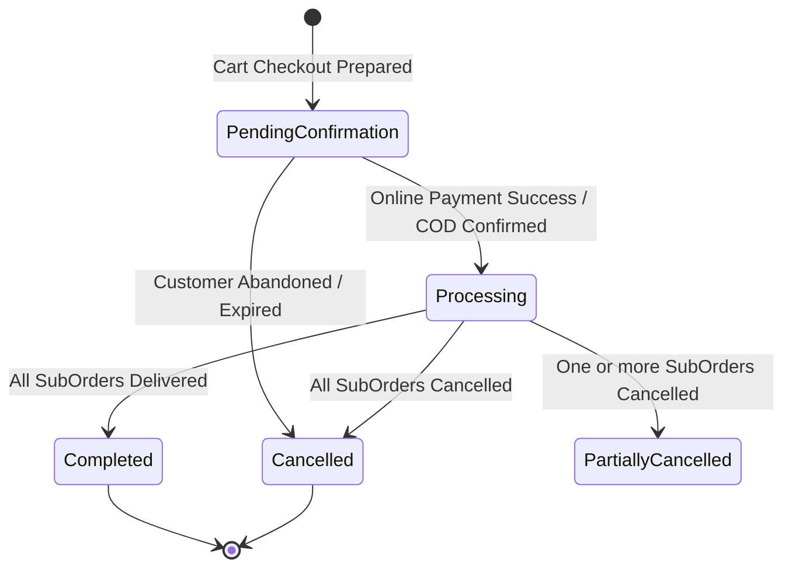
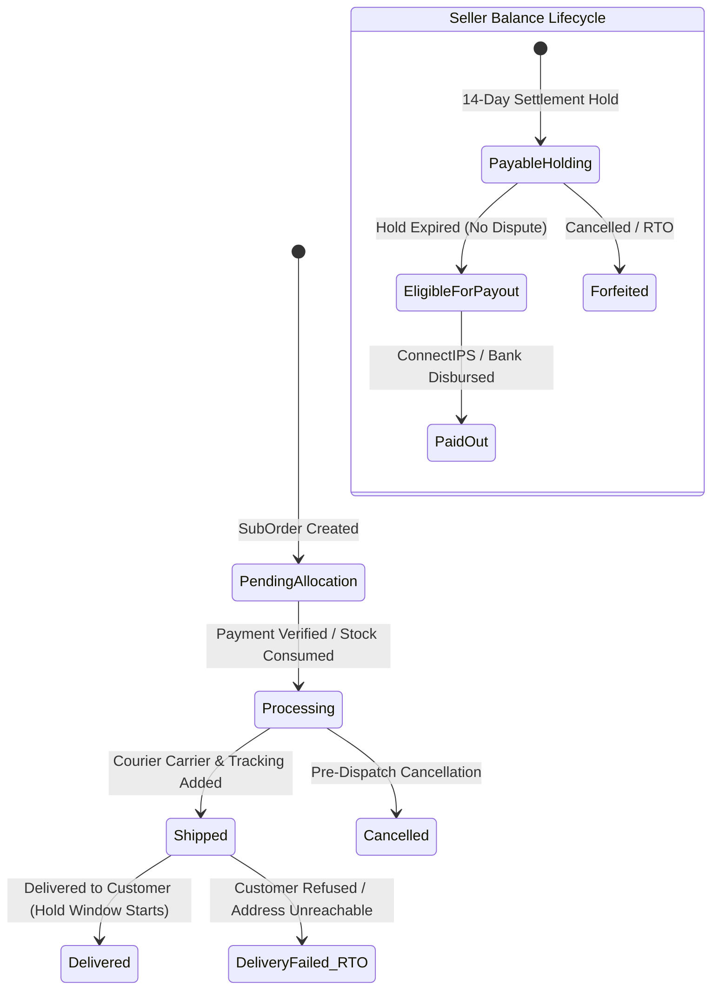
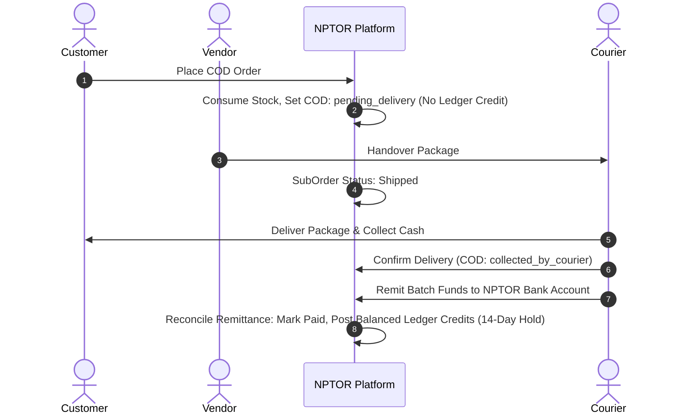

# NPTOR Store — Phase 5 Completion Report: Order Placement, State Workflows & Settlement Accounting

**Date:** 2026-10-24  
**Branch:** `feature/store-commerce-foundation`  
**Status:** Completed & Verified  

---

## 1. Executive Summary

Phase 5 (**Payment Integration, COD Confirmation & Order Placement Workflows**) has been successfully implemented and verified locally on `feature/store-commerce-foundation`.

All objectives established in the Phase 5 authorization have been achieved:
1. **Bank Encryption, Key Management & Multi-Key Rotation:** Implemented `cryptography.fernet.MultiFernet` architecture in `vendors/crypto.py` allowing a dedicated, out-of-band `BANK_DETAILS_ENCRYPTION_KEY` or `BANK_DETAILS_ENCRYPTION_KEYS` (comma-delimited) supporting zero-downtime key rotation. Missing or mismatched keys raise explicit `KeyConfigurationError` / `DecryptionError` to eliminate silent data corruption. Plaintext bank account numbers are never logged or exposed.
2. **Reconciled Commission & Balanced Settlement Accounting:** Formalized and implemented the mathematical rules governing merchandise subtotals, platform commissions, discounts, shipping charges, customer refunds, commission reversals, failed delivery RTO freight adjustments, and the 14-day settlement hold window.
3. **Provider-Independent Payment Boundary:** Created `BasePaymentAdapter` and `DummyPaymentAdapter` in `orders/adapters/` providing deterministic initiation, callback verification, and mock refund handling without invoking real financial rails.
4. **Order Placement & State Transition Engine:** Created `OrderWorkflowService` orchestrating online payment confirmation, COD order confirmation, deterministic stock reservation consumption or restoration, fulfillment progression (`processing` -> `shipped` -> `delivered`), COD courier remittance reconciliation, pre-dispatch cancellation reversals, and failed delivery RTO handling.
5. **Multi-Tenant Access Controls:** Implemented and verified views in `orders/views.py` ensuring customers can only access their own orders and sellers can strictly access only their assigned suborders.
6. **Zero Educational Impact & Pristine Baseline:** Existing educational checkout (`payments.models.PaymentOrder`), courses, exams, and subscriptions remain untouched. All 57 Store tests pass (100% pass rate).

---

## 2. Bank Encryption & Key Management Specification

### A. Dedicated Key Management
- The primary encryption key is loaded from the environment variable `BANK_DETAILS_ENCRYPTION_KEY` (or `BANK_DETAILS_ENCRYPTION_KEYS` for multiple keys), managed completely outside source control and separated from Django's `SECRET_KEY`.
- In development/test environments only, a deterministic SHA-256 fallback from `SECRET_KEY` is provided if no environment variable is present.

### B. Multi-Key Rotation Procedure (`MultiFernet`)
- **Key Generation:** A new 32-byte URL-safe base64 key is generated via `Fernet.generate_key()`.
- **Rotation Configuration:** The new key is prepended to `BANK_DETAILS_ENCRYPTION_KEYS` (e.g. `NEW_PRIMARY_KEY,OLD_FALLBACK_KEY`).
- **Seamless Operation:** 
  - New records are encrypted exclusively using `NEW_PRIMARY_KEY`.
  - Existing records encrypted with `OLD_FALLBACK_KEY` continue to decrypt seamlessly on read.
- **Background Migration / Re-encryption:** A maintenance utility (`rotate_bank_account_ciphertext()`) re-encrypts historical records under `NEW_PRIMARY_KEY`.
- **Retirement:** Once all rows have been migrated, `OLD_FALLBACK_KEY` is safely decommissioned from the environment variable.

### C. Error Handling & Safeguards
- Attempting to decrypt with a removed or mismatched key raises `DecryptionError`, preventing silent empty-string corruption.
- Malformed keys raise `KeyConfigurationError` at initialization.
- Decrypted plaintext account numbers are strictly held in-memory and never logged or serialized in error handlers.

---

## 3. Commission, Refund & Settlement Accounting Rules

### A. Financial Component Definitions
For each seller `SubOrder`:
1. `items_subtotal` = $\sum (\text{item.unit\_price} \times \text{item.quantity})$
2. `item_discounts` = Direct item discounts or allocated voucher reductions.
3. `net_merchandise_subtotal` = $\max(0.00, \text{items\_subtotal} - \text{item\_discounts})$
4. `customer_shipping_charge` = Shipping fee paid by customer for this package.
5. `tax_amount` = Applicable VAT or tax (if separately assessed).
6. `suborder_grand_total` = $\text{net\_merchandise\_subtotal} + \text{customer\_shipping\_charge} + \text{tax\_amount}$

### B. Commission Calculation
Platform commission applies strictly to sold merchandise, never to shipping fees or government taxes:
$$\text{commissionable\_base} = \text{net\_merchandise\_subtotal}$$
$$\text{platform\_commission} = \text{quantize}\left(\text{commissionable\_base} \times \frac{\text{vendor.commission\_rate}}{100}, \text{Decimal('0.01')}, \text{ROUND\_HALF\_UP}\right)$$

### C. Seller Net Earning & Payout
- **When Seller Fulfills Shipping Directly:**
  $$\text{seller\_net\_payout} = (\text{net\_merchandise\_subtotal} - \text{platform\_commission}) + \text{customer\_shipping\_charge}$$
- **When Platform Coordinates & Pays Courier Directly:**
  $$\text{seller\_net\_payout} = \text{net\_merchandise\_subtotal} - \text{platform\_commission}$$

### D. Cancellations & Customer Refunds
- **Full Cancellation Prior to Dispatch:**
  - Customer receives 100% refund.
  - Platform commission is 100% reversed.
  - Reserved/consumed physical stock is restored to available inventory.
  - Immutable ledger postings:
    - Debit: `ENTRY_DEBIT_REFUND` ($-\text{items\_subtotal}$)
    - Credit: `ENTRY_CREDIT_COMMISSION_REVERSAL` ($+\text{platform\_commission}$)
  - Seller payable status transitions to `forfeited`.

### E. Failed Delivery & Return-to-Origin (RTO)
- In the event of customer refusal or non-delivery:
  - Inventory is restored to available stock.
  - SubOrder status transitions to `delivery_failed`.
  - For COD, master order `cod_collection_status` transitions to `delivery_refused`.
  - If the seller agreement specifies vendor liability for failed delivery freight, a debit entry is posted:
    - Debit: `ENTRY_DEBIT_RTO_SHIPPING` ($-\text{rto\_penalty}$)
  - Seller payable status transitions to `forfeited`.

### F. COD Remittance Reconciliation Workflow
- **Rule:** COD orders are **never** credited to the seller's ledger at order placement or dispatch.
- **Workflow:**
  1. Placement $\rightarrow$ `cod_collection_status = pending_delivery`. Stock consumed. No ledger credit.
  2. Courier Delivery $\rightarrow$ `cod_collection_status = collected_by_courier`. Cash in courier possession.
  3. Bank Remittance & Manifest Audit $\rightarrow$ Courier remits collected cash to NPTOR bank account.
  4. Reconciliation $\rightarrow$ Admin verifies remittance against suborder:
     - `cod_collection_status = reconciled`
     - Master payment status transitions to `successful`
     - Credit: `ENTRY_CREDIT_COD_REMITTED` ($+\text{items\_subtotal}$)
     - Debit: `ENTRY_DEBIT_COMMISSION` ($-\text{platform\_commission}$)
     - Optional Debit: `ENTRY_DEBIT_COURIER_SHIPPING` ($-\text{courier\_fee}$)
     - SubOrder enters `payable_status = holding` with `settlement_hold_until = now + 14 days`.

### G. Pending vs. Available Balances
- Seller earnings remain in `is_settled = False` during the 14-day settlement hold window.
- Once the hold expires without return or dispute, balance transitions to eligible for disbursement batching.

---

## 4. State Transition Workflows

### A. Master Order State Transitions



### B. Seller SubOrder Fulfillment & Payable Transitions



### C. Cash on Delivery (COD) Remittance Lifecycle



---

## 5. Verification & Test Evidence

### A. Store Test Suite Results
```powershell
.\venv\Scripts\python.exe manage.py test orders vendors cart store --keepdb
```
**Output:**
```text
Ran 57 tests in 141.404s
OK
Preserving test database for alias 'default'...
Found 57 test(s).
```
- `vendors.tests_bank_crypto`: 6/6 tests passing (dedicated key encryption, MultiFernet rotation, rotation re-encryption, key mismatch detection, corrupted ciphertext detection, model property masking).
- `orders.tests_order_workflows`: 5/5 tests passing (online payment & inventory consumption, COD workflow & remittance reconciliation, suborder cancellation & ledger reversals, failed delivery RTO, customer and vendor tenant access controls).
- `orders.tests_checkout`: 7/7 tests passing (Nepal delivery gating, digital worldwide checkout, COD eligibility rules, order splitting, idempotency).
- `cart.tests_cart_service`: 7/7 tests passing.
- `vendors.tests` & `vendors.tests_onboarding`: 15/15 tests passing.
- `store.tests`: 17/17 tests passing.

---

## 6. Repository & Working Tree Status

Exact output of `git status --short`:
```text
 M objective_exam/settings.py
 M objective_exam/urls.py
?? cart/
?? docs/store/
?? orders/
?? store/
?? templates/orders/
?? templates/store/
?? templates/vendors/
?? vendors/
```

**Reconciliation of Terminology:**
- Tracked modified files are strictly configuration registrations: `objective_exam/settings.py` (added new store apps to `INSTALLED_APPS`) and `objective_exam/urls.py` (registered store URL namespaces).
- All new functionality resides cleanly in isolated, untracked directories (`cart/`, `orders/`, `store/`, `vendors/`, and related templates/docs).
- Zero commits have been created on this branch (`feature/store-commerce-foundation`), no commits pushed, and no existing files or Git history altered.
- Staging and production environments remain 100% untouched.

---

## 7. Remaining Risks & Phase 6 Recommendations

1. **Digital Download Security (Phase 6):** Ensure high-volume binary downloads are streamed via Django chunked file responses (`FileResponse`) with cryptographically signed, single-use, rate-limited tokens rather than exposing filesystem paths.
2. **Payment Gateway Integration (Phase 6):** Once gateway credentials (eSewa / Khalti / Fonepay) are formally selected and verified, concrete adapters adhering to `BasePaymentAdapter` should be plugged in without modifying core order workflow logic.
