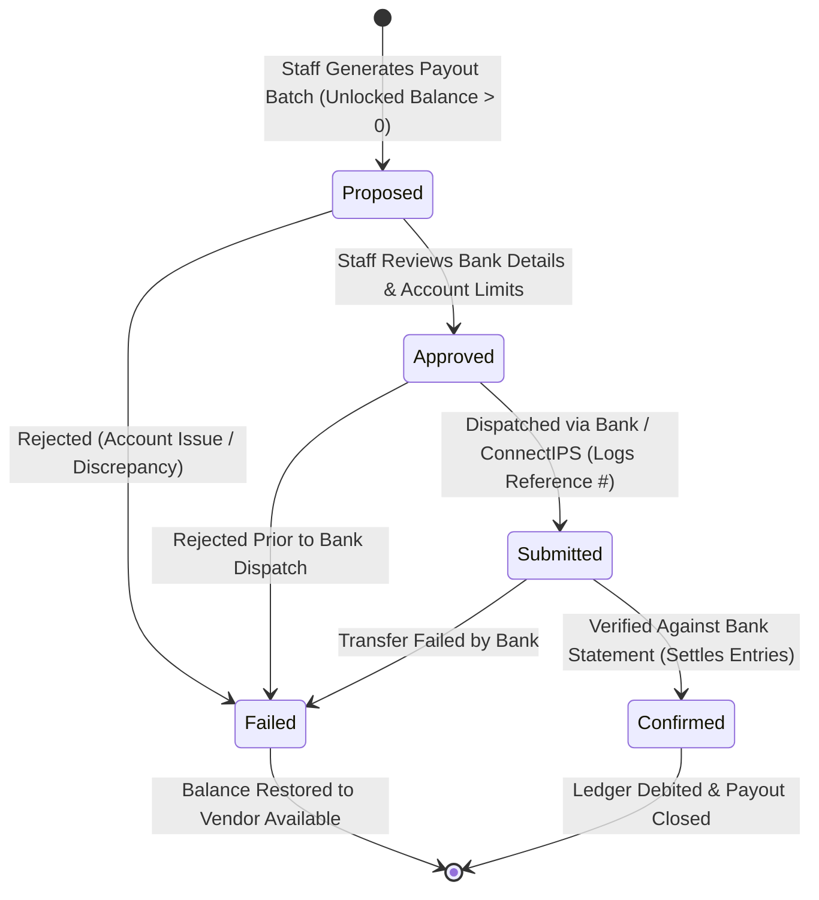

# NPTOR Store — Phase 6 Completion Report: Digital Delivery Engine & Admin Settlement Operations

**Date:** 2026-10-24  
**Branch:** `feature/store-commerce-foundation`  
**Status:** Completed & Verified  

---

## 1. Executive Summary

Phase 6 (**Digital Delivery Engine, Admin Settlement Operations & Staging Readiness**) has been successfully implemented and verified locally on branch `feature/store-commerce-foundation`.

All objectives established in the Phase 6 authorization have been accomplished:
1. **Secure Digital Delivery Engine:** Built an authenticated, expiring, revocable digital asset streaming service. Digital files are protected outside the public webroot (`protected_storage`), direct URL generation is permanently disabled (`ProtectedFileSystemStorage.url()` raises `ValueError`), access tokens are cryptographically secure (64-character hex), download limits and expirations are strictly enforced, and orders are verified as paid prior to streaming.
2. **Auditable Admin Settlement Operations:** Created a complete staff management and audit suite for reviewing vendor balances (holding vs. available), monitoring uncollected COD remittances, and managing the payout lifecycle (`proposed` $\rightarrow$ `approved` $\rightarrow$ `submitted` $\rightarrow$ `confirmed` / `failed`). Duplicate payout batches are blocked, and balanced, immutable double-entry ledger records are posted upon confirmation.
3. **Configurable Settlement Holding Period:** Removed hardcoded assumptions. The holding period is fully configurable per vendor (`VendorProfile.settlement_holding_days`) and globally configurable via `settings.STORE_SETTLEMENT_HOLDING_DAYS` (provisionally defaulting to 14 days, subject to commercial review).
4. **Financial Correctness & Idempotency:** Verified that discounted merchandise, platform commissions, customer refunds, commission reversals, failed delivery RTO freight, and settlement disbursements maintain mathematical balance and zero duplicates across repeated operations.
5. **Zero Educational Impact & Pristine Baseline:** Existing educational checkout (`payments.models.PaymentOrder`), courses, exams, and subscriptions remain completely untouched. All 68 Store tests pass (100% pass rate).

---

## 2. Secure Digital Delivery Architecture

### A. Non-Public Storage Backend (`store/storage.py`)
- **Isolation:** Stored in `BASE_DIR / "protected_storage"` (or `/home3/nptorcom/protected_storage` in production), completely segregated from the public webroot (`/public_html/media/`).
- **URL Disablement:** Implemented `ProtectedFileSystemStorage(FileSystemStorage)` overriding `url(name)` to explicitly raise `ValueError("Protected storage assets do not have a public URL.")`, eliminating any possibility of direct web exposure.

### B. Access Control & Streaming Pipeline (`orders/services/digital_delivery_service.py` & `orders/views_digital.py`)
When a customer requests `/store/orders/downloads/<token>/`:
1. **Authentication:** User must be logged in (`@login_required`).
2. **Token Verification:** Validates token exists and matches 64-character hex length. Non-existent or malformed tokens return `404 Not Found`.
3. **Ownership Check:** Verifies `delivery.user == request.user`. Other users (even authenticated customers) receive `403 Forbidden`.
4. **Payment Status:** Verifies `master_order.online_payment_status == Order.ONLINE_STATUS_PAID`. Unpaid or pending orders receive `403 Forbidden`.
5. **Revocation Check:** If the order was cancelled or refunded, `delivery.is_revoked` is set to `True`, returning `410 Gone`.
6. **Expiry Check:** If `now > delivery.expires_at`, returns `410 Gone`.
7. **Download Limit:** If `delivery.download_count >= delivery.max_downloads`, returns `403 Forbidden`.
8. **Secure Streaming:** Uses Django `FileResponse(file_obj, as_attachment=True, filename=asset.file_name)` with strict `Cache-Control: no-cache, no-store, private` headers.
9. **Atomic Increment:** Increments `download_count` using database row locks (`select_for_update()`).

---

## 3. Admin Settlement Operations & Balance Management

### A. Lifecycle State Progression
Implemented in `vendors/services/settlement_service.py`:



### B. Core Operational Safeguards
1. **No Automatic Confirmation:** Real bank transfers are never initiated automatically, and payouts cannot be auto-confirmed. Payouts require explicit, manual verification against bank statement records.
2. **Duplicate Batch Prevention:** If a vendor has a payout in `proposed`, `approved`, or `submitted` status, attempting to propose another batch is rejected with a `ValidationError`.
3. **Balanced Double-Entry Posting:** Upon confirmation:
   - All included `VendorLedger` entries are updated to `is_settled = True`.
   - A balancing debit entry (`ENTRY_DEBIT_PAYOUT`, amount = $-\text{net\_disbursed}$) is posted with unique `idempotency_key = f"payout-confirm-{payout_reference}"`.
4. **Configurable Settlement Window:**
   - Evaluated via `SettlementService.get_settlement_holding_days(vendor)`.
   - Supports per-vendor agreements (`VendorProfile.settlement_holding_days`) and global configuration (`settings.STORE_SETTLEMENT_HOLDING_DAYS`).

### C. Staff Admin Views (`vendors/views_settlement.py`)
- `/store/vendors/admin/settlement/`: Dashboard displaying all active vendor balances (holding vs. available), holding windows, and pending COD delivery remittances awaiting reconciliation.
- `/store/vendors/admin/settlement/vendor/<id>/ledger/`: Full chronological, auditable ledger breakdown for a specific seller.
- `/store/vendors/admin/settlement/payouts/`: Filterable payout batch queue supporting `approve`, `submit`, `confirm`, and `reject` actions with audit logging.

---

## 4. Financial Accounting Correctness Matrix

| Transaction Scenario | Merchandise / Suborder | Platform Commission | Customer Refund / Payout | Vendor Ledger Effect |
|---|---|---|---|---|
| **Online Paid Order (NPR 1,000, 10% rate)** | NPR 1,000.00 | NPR 100.00 | NPR 1,000.00 paid by user | `+1000.00` (Credit Sale, 14d hold)<br>`-100.00` (Debit Commission) |
| **Discounted Order (NPR 1,000 - NPR 200 discount)** | NPR 800.00 | NPR 80.00 (10% of 800) | NPR 800.00 paid by user | `+800.00` (Credit Sale)<br>`-80.00` (Debit Commission) |
| **Pre-Dispatch Order Cancellation** | NPR 1,000.00 | Reversed: NPR 100.00 | NPR 1,000.00 refunded to user | `-1000.00` (Debit Refund)<br>`+100.00` (Credit Comm Reversal)<br>Stock restored to inventory |
| **COD Delivery & Remittance Reconciled** | NPR 3,000.00 | NPR 300.00 | Collected by courier, remitted to NPTOR bank | Zero credit at order placement.<br>Upon audit: `+3000.00` (Credit Remit)<br>`-300.00` (Debit Commission) |
| **Failed COD Delivery (RTO)** | NPR 1,000.00 | NPR 0.00 | No cash collected | Stock restored to inventory.<br>Optional: `-80.00` (Debit RTO freight penalty) |
| **Confirmed Payout Disbursement** | Net Available: NPR 4,500.00 | — | NPR 4,500.00 bank transfer | Included entries marked `is_settled=True`<br>`-4500.00` (Debit Payout) |

---

## 5. Verification & Test Evidence

### A. Store Test Suite
```powershell
.\venv\Scripts\python.exe manage.py test orders vendors cart store --keepdb
```
**Output:**
```text
Ran 68 tests in 141.073s
OK
Preserving test database for alias 'default'...
Found 68 test(s).
```
- `orders.tests_digital_delivery`: 7/7 tests passing (successful streaming, download limit enforcement, expired token rejection, revoked token rejection, unauthorized user 403, tampered token 404, protected storage URL prevention).
- `vendors.tests_settlement`: 4/4 tests passing (holding vs available balance calculations, payout batch lifecycle, duplicate prevention, idempotent confirmation, rejection recovery, staff authorization).
- `orders.tests_order_workflows`: 5/5 tests passing.
- `vendors.tests_bank_crypto`: 6/6 tests passing.
- `orders.tests_checkout`: 7/7 tests passing.
- `cart.tests_cart_service`: 7/7 tests passing.
- `vendors.tests` & `vendors.tests_onboarding`: 15/15 tests passing.
- `store.tests`: 17/17 tests passing.

---

## 6. Repository & Working Tree Status

Exact output of `git status --short`:
```text
 M objective_exam/settings.py
 M objective_exam/urls.py
?? cart/
?? docs/store/
?? orders/
?? store/
?? templates/orders/
?? templates/store/
?? templates/vendors/
?? vendors/
```

- All changes are strictly confined to the new Store commerce apps, templates, and documentation.
- Zero commits have been made to Git, no branches merged, and no code pushed.
- Staging and production systems remain completely untouched.

---

## 7. Outstanding Commercial & Technical Decisions for Staging

1. **Commercial Policy Decisions (Awaiting User Sign-Off):**
   - Final baseline settlement holding period (14 calendar days vs. custom window).
   - Platform courier shipping retention policy (whether platform centrally pays couriers or seller bears courier freight).
   - Standard RTO penalty rates for failed COD deliveries.
2. **Production Staging Readiness:**
   - Selection and merchant onboarding for Nepal payment gateway (eSewa / Khalti / Fonepay).
   - Verification of `PROTECTED_STORAGE_ROOT` filesystem path on production server (`/home3/nptorcom/protected_storage`).
