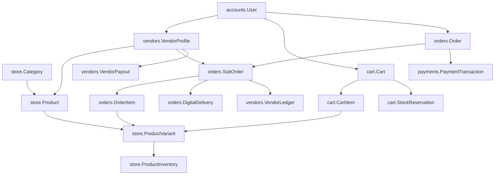
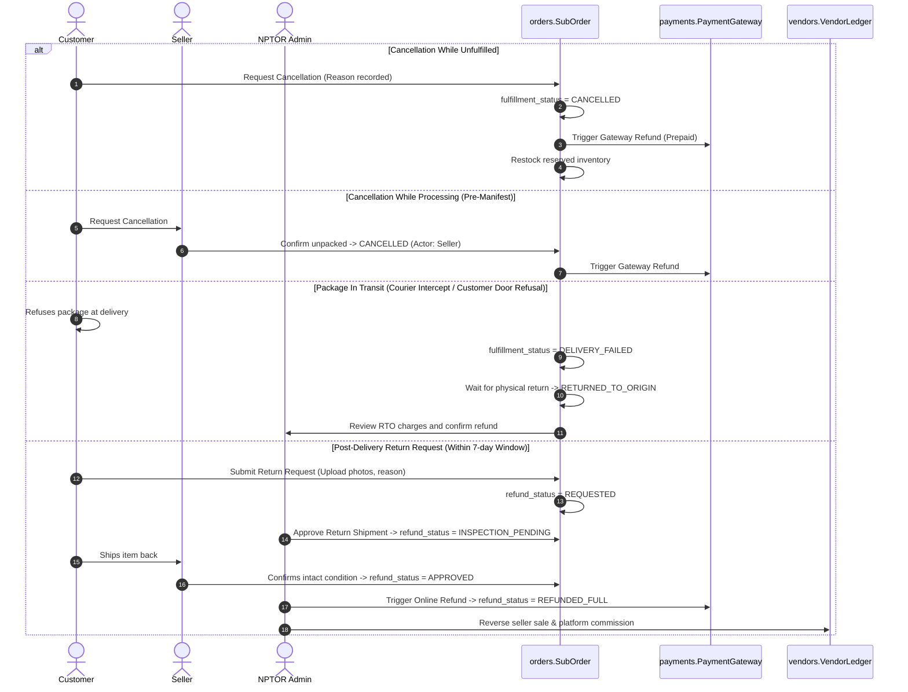
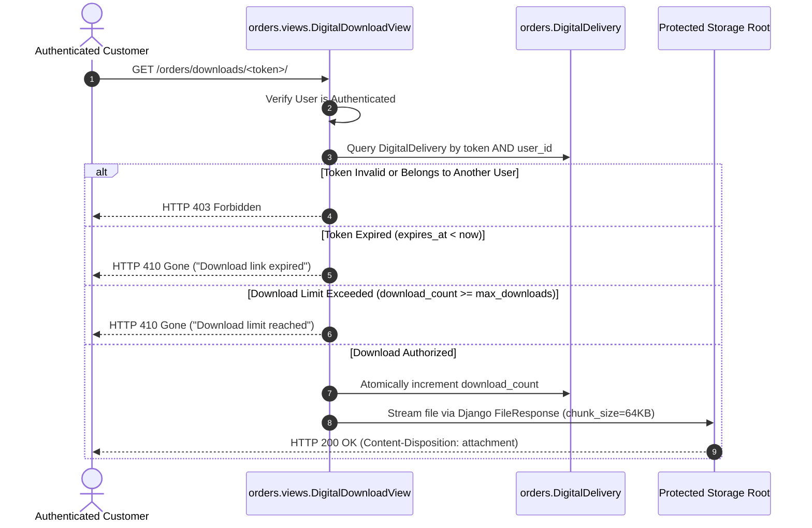

# NPTOR Store — Comprehensive Architecture & Implementation Design

**Document Version:** 4.0.0-MARKET-ALIGNED  
**Date:** 2026-10-23  
**Status:** Implementation-Ready Architecture Specification (Market Scope Aligned; Awaiting Final Owner Sign-Off)  
**File Location:** `docs/store/STORE_ARCHITECTURE_DESIGN.md`  
**Target Codebase:** NPTOR Platform (`objective_exam`, Django 6.0, Python 3.12, MySQL/MariaDB InnoDB)

---

## Document Taxonomy & Legend
Statements throughout this design are strictly categorized:
- `[CONFIRMED REPOSITORY FINDING]`: Grounded in verified code, settings, migrations, and database schema in the current repository (`commit fd4d18d`).
- `[DESIGN SPECIFICATION]`: Formal architectural, data, or workflow design implemented to meet project requirements.
- `[PROVISIONAL DEFAULT / RECOMMENDATION]`: A sound operational default proposed by the architecture team, subject to commercial, legal, or policy ratification.
- `[UNRESOLVED DECISION]`: Explicit decision point requiring project owner approval before code execution.
- `[LEGAL / TAX NOTICE]`: Regulatory question requiring qualified local legal/tax counsel in Nepal or target jurisdictions.

---

## Table of Contents
1. [Dual Market Architecture: Global Learning vs. Nepal-First Store](#1-dual-market-architecture-global-learning-vs-nepal-first-store)
2. [Confirmed Repository Reality & Reusability Baseline](#2-confirmed-repository-reality--reusability-baseline)
3. [App & Module Boundaries (Modular Monolith)](#3-app--module-boundaries-modular-monolith)
4. [Data Models, Schema Design & Database Constraints](#4-data-models-schema-design--database-constraints)
5. [Decoupled Multi-Dimensional State Architecture](#5-decoupled-multi-dimensional-state-architecture)
6. [Operational Workflows, Mixed Carts & Geography Gates](#6-operational-workflows-mixed-carts--geography-gates)
7. [Cancellation, Returns, Inspection & Refund Architecture](#7-cancellation-returns-inspection--refund-architecture)
8. [Failed COD Delivery, RTO & Freight Liability Engine](#8-failed-cod-delivery-rto--freight-liability-engine)
9. [Double-Entry Accounting, Commissions & Seller Settlement](#9-double-entry-accounting-commissions--seller-settlement)
10. [Payment Provider & Currency Separation Architecture](#10-payment-provider--currency-separation-architecture)
11. [Inventory Concurrency, Stock Locking & Checkout Validation](#11-inventory-concurrency-stock-locking--checkout-validation)
12. [Protected Digital Asset Delivery Architecture](#12-protected-digital-asset-delivery-architecture)
13. [Multi-Tenant Seller Isolation & Data Minimization](#13-multi-tenant-seller-isolation--data-minimization)
14. [Backward Compatibility with Educational Purchases](#14-backward-compatibility-with-educational-purchases)
15. [Nepalese Legal, Tax, Regulatory & Contractual Compliance](#15-nepalese-legal-tax-regulatory--contractual-compliance)
16. [Comprehensive Testing & Failure Mode Validation](#16-comprehensive-testing--failure-mode-validation)
17. [Phased MVP Implementation Roadmap & Rollback Strategy](#17-phased-mvp-implementation-roadmap--rollback-strategy)
18. [Final Decision Register](#18-final-decision-register)

---

## 1. Dual Market Architecture: Global Learning vs. Nepal-First Store

A core principle of this architecture is the deliberate bifurcation of market scope between **NPTOR Education** and **NPTOR Store**:

```
┌─────────────────────────────────────────────────────────────────────────────┐
│                          NPTOR PLATFORM SCOPE                               │
├──────────────────────────────────────┬──────────────────────────────────────┤
│      GLOBAL LEARNING PLATFORM        │        NEPAL-FIRST MARKETPLACE       │
│   (Courses, Tracks, Exams, Orgs)     │          (NPTOR Store App)           │
├──────────────────────────────────────┼──────────────────────────────────────┤
│ • Worldwide availability             │ • Physical delivery initially NEPAL  │
│ • International students & colleges  │ • Local Nepal seller onboarding      │
│ • Educational single-item checkout   │ • Cash on Delivery (COD) within Nepal│
│ • Independent pricing & currency     │ • Default Currency: NPR (Store)      │
│ • Global gateway pipeline (INR/USD)  │ • Nepal domestic gateways (eSewa/etc)│
│ • Zero physical shipping constraints │ • Digital Store products: GLOBAL*    │
└──────────────────────────────────────┴──────────────────────────────────────┘
*Subject to seller intellectual property rights and payment provider acceptance.
```

### Strategic Boundaries
1. **Global Learning Platform Preserved:** NPTOR's existing organizations, institutional portals, video courses, exam engines, practice questions, and subscriptions remain open to customers worldwide. **Under no circumstances will physical delivery constraints or Nepal-only policies be applied to educational resources, organizations, or existing checkouts.**
2. **Nepal-First Physical Marketplace:** The physical Store initially focuses on domestic retail within Nepal:
   - Platform-owned physical goods and approved third-party Nepalese sellers.
   - Domestic fulfillment and manual courier tracking (e.g. Pathao, Nepal Post, Sundar, local couriers).
   - Cash on Delivery (COD) restricted strictly to serviceable delivery addresses within Nepal.
   - Cross-border physical shipping is explicitly **out of scope** for the initial MVP.
3. **Globally Available Digital Store Goods:** Digital Store items (e-books, downloadable test bundles, revision guides, software utilities) are architected for international customer access wherever payment gateway coverage and copyright laws permit. Digital products are **never** constrained by physical geography.
4. **Currency & Payment Decoupling:** Educational checkouts and Store checkouts maintain independent currency and gateway pipelines, preventing local marketplace settings from altering international educational commerce.

---

## 2. Confirmed Repository Reality & Reusability Baseline

Direct inspection of the repository (`commit fd4d18d`) establishes the concrete baseline:

| Component | Confirmed Codebase Reality | Architectural Impact on Commerce |
| :--- | :--- | :--- |
| **Framework** | Django 6.0 on Python 3.12 | Modern ORM, generated columns, check constraints, async view support. |
| **Database Engine** | MySQL / MariaDB (InnoDB, `utf8mb4_unicode_ci`) | Strict mode (`STRICT_TRANS_TABLES`) active. Foreign keys and row-level locking (`select_for_update`) supported. |
| **Hosting & Runtime** | CloudLinux cPanel / LiteSpeed with Phusion Passenger WSGI | Process-based execution model. Synchronous HTTP request cycle with standard timeouts (~30–60s). |
| **Caching Engine** | `django.core.cache.backends.locmem.LocMemCache` | **Per-process in-memory cache**. Does **not** share state across worker processes. **Shopping carts and stock reservations must be stored in the database, not in cache.** |
| **Background Tasks** | No Celery, Redis, RQ, or worker daemon installed | Async tasks do not exist natively. Heavy operations must run synchronously (optimized < 300ms) or via cron management commands. |
| **Payment Gateways** | `payments.gateways.factory.PaymentGatewayFactory` only registers `DummyPaymentGateway` | **No live payment gateway is configured or active.** The system must use a provider-independent interface. Live gateway selection requires verification. |
| **Existing Purchases** | `payments.models.PaymentOrder` & `subscriptions.SubscriptionPlan` | Hardcoded default `currency = 'INR'`. 1:1 with single educational resources (`course`, `track`, `subscription_plan`, `exam`). Its `clean()` method raises `ValidationError` if more than one item is attached. **Must not be modified to avoid regressions in existing learning purchases.** |
| **User Identity** | `django.contrib.auth.models.User` with `accounts.UserProfile` | Standard User model in use. `UserProfile` stores country, phone, address, and verification state. |
| **Authentication** | `accounts.models.EmailOTP` & `allauth` (Google OAuth) | SHA-256 hashed OTP login and Google social authentication active and verified. |
| **Content Moderation** | `courses.models.Course` | Battle-tested approval state machine (`draft`, `pending`, `approved`, `changes_required`, `rejected`) directly reusable for product listing reviews. |
| **Frontend Shells** | Bulma 0.9.4 + custom styling (`theme.css`, `components.css`) | Responsive student layout (`templates/layouts/student/`) and admin layout (`templates/layouts/admin/`) ready for storefront and seller workspace. |

---

## 3. App & Module Boundaries (Modular Monolith)

To prevent circular dependencies and cleanly decouple commerce from the educational assessment domain, the marketplace is organized into four dedicated applications:

```
objective_exam/
├── accounts/          [Existing] User model, UserProfile, EmailOTP authentication
├── payments/          [Existing] Gateway abstraction, PaymentTransaction, PaymentWebhookEvent
├── courses/, quiz/    [Existing] Educational content, assessments, exams
│
├── store/             [New] Unified product catalog, categories, variants, inventory, customer reviews
├── cart/              [New] Persistent database carts, real-time pricing validation, stock reservation holds
├── orders/            [New] Master Order, Seller SubOrders, Shipping Addresses, Digital Delivery tokens
└── vendors/           [New] VendorProfile, KYC verification, commission rules, vendor ledger, payout batches
```

### Module Responsibilities & Flow



---

## 4. Data Models, Schema Design & Database Constraints

### 4.1 `store` App Models

#### `Category`
Hierarchical product taxonomy supporting nested navigation.
- `id`: BigAutoField
- `name`: CharField(100)
- `slug`: SlugField(120, unique=True)
- `parent`: ForeignKey('self', null=True, blank=True, on_delete=models.CASCADE, related_name='children')
- `is_active`: BooleanField(default=True, db_index=True)
- `display_order`: PositiveIntegerField(default=0)
- `default_commission_rate`: DecimalField(max_digits=5, decimal_places=2, null=True, blank=True, help_text="Category commission override; NULL inherits vendor baseline.")

#### `Product`
Master product record. Supports NPTOR-owned inventory (`vendor=None`) and seller-owned inventory (`vendor=VendorProfile`).
- `id`: BigAutoField
- `vendor`: ForeignKey('vendors.VendorProfile', null=True, blank=True, on_delete=models.PROTECT, related_name='products', help_text="NULL denotes NPTOR Platform-owned product")
- `title`: CharField(255)
- `slug`: SlugField(280, unique=True)
- `category`: ForeignKey(Category, on_delete=models.PROTECT, related_name='products')
- `product_type`: CharField(max_length=20, choices=[('physical', 'Physical Product'), ('digital', 'Digital Download')], db_index=True)
- `description`: TextField()
- `specifications`: JSONField(default=dict, blank=True)
- `is_cod_eligible`: BooleanField(default=True, help_text="Can this physical product be ordered via Cash on Delivery within Nepal?")
- `is_internationally_available`: BooleanField(default=False, help_text="Can this product be purchased outside Nepal? (Digital products default to True; physical products default to False for MVP)")
- `approval_status`: CharField(max_length=20, choices=[('draft', 'Draft'), ('pending', 'Pending Approval'), ('approved', 'Approved'), ('changes_required', 'Changes Required'), ('rejected', 'Rejected')], default='draft', db_index=True)
- `is_active`: BooleanField(default=False, db_index=True, help_text="Seller visibility toggle; only visible on storefront if approved=True and is_active=True")
- `reviewed_by`: ForeignKey(settings.AUTH_USER_MODEL, null=True, blank=True, on_delete=models.SET_NULL, related_name='reviewed_store_products')
- `review_notes`: TextField(blank=True, default='')
- `submitted_at`: DateTimeField(null=True, blank=True)
- `reviewed_at`: DateTimeField(null=True, blank=True)
- `created_at`: DateTimeField(auto_now_add=True)
- `updated_at`: DateTimeField(auto_now=True)

#### `ProductVariant`
Stock-keeping unit (SKU) level representation.
- `id`: BigAutoField
- `product`: ForeignKey(Product, on_delete=models.CASCADE, related_name='variants')
- `sku`: CharField(64, unique=True, db_index=True)
- `variant_name`: CharField(100, default='Standard')
- `price`: DecimalField(max_digits=12, decimal_places=2, validators=[MinValueValidator(0)])
- `compare_at_price`: DecimalField(max_digits=12, decimal_places=2, null=True, blank=True)
- `currency`: CharField(max_length=10, default='NPR', help_text="Product pricing currency; defaults to NPR for Nepal Store")
- `weight_grams`: PositiveIntegerField(default=0, help_text="Physical weight in grams for shipping calculation")
- `is_active`: BooleanField(default=True)

#### `ProductInventory`
Inventory tracking with strict non-negative check constraints.
- `id`: BigAutoField
- `variant`: OneToOneField(ProductVariant, on_delete=models.CASCADE, related_name='inventory')
- `quantity`: IntegerField(default=0)
- `reserved_quantity`: IntegerField(default=0, help_text="Stock temporarily locked in active checkouts")
- `low_stock_threshold`: PositiveIntegerField(default=5)
- `allow_backorder`: BooleanField(default=False)
- `updated_at`: DateTimeField(auto_now=True)
- *Constraints:*
  - `CheckConstraint(check=Q(quantity >= 0), name='inventory_quantity_non_negative')`
  - `CheckConstraint(check=Q(reserved_quantity >= 0), name='inventory_reserved_non_negative')`

#### `ProductDigitalAsset`
Metadata for digital products stored outside public web roots.
- `id`: BigAutoField
- `product`: OneToOneField(Product, on_delete=models.CASCADE, related_name='digital_asset')
- `file`: FileField(upload_to='protected_media/store/digital_assets/')
- `file_name`: CharField(255)
- `file_size_bytes`: BigIntegerField()
- `checksum_sha256`: CharField(max_length=64)
- `max_downloads_per_purchase`: PositiveIntegerField(default=5)
- `download_validity_days`: PositiveIntegerField(default=365)

---

### 4.2 `cart` App Models

#### `Cart`
Database-backed persistent shopping cart.
- `id`: BigAutoField
- `user`: ForeignKey(settings.AUTH_USER_MODEL, null=True, blank=True, on_delete=models.CASCADE, related_name='store_carts')
- `session_key`: CharField(max_length=40, db_index=True, blank=True, default='')
- `currency`: CharField(max_length=10, default='NPR', help_text="Store cart currency; independent of educational currency")
- `created_at`: DateTimeField(auto_now_add=True)
- `updated_at`: DateTimeField(auto_now=True)
- *Indexes:* `Index(fields=['session_key', 'updated_at'])`, `Index(fields=['user', 'updated_at'])`

#### `CartItem`
- `id`: BigAutoField
- `cart`: ForeignKey(Cart, on_delete=models.CASCADE, related_name='items')
- `variant`: ForeignKey('store.ProductVariant', on_delete=models.CASCADE)
- `quantity`: PositiveIntegerField(default=1, validators=[MinValueValidator(1)])
- `unit_price_snapshot`: DecimalField(max_digits=12, decimal_places=2)
- `added_at`: DateTimeField(auto_now_add=True)
- *Constraints:* `UniqueConstraint(fields=['cart', 'variant'], name='unique_cart_variant')`

#### `StockReservation`
Temporary stock hold during checkout to prevent overselling.
- `id`: BigAutoField
- `cart`: ForeignKey(Cart, on_delete=models.CASCADE, related_name='stock_reservations')
- `variant`: ForeignKey('store.ProductVariant', on_delete=models.CASCADE)
- `reserved_units`: PositiveIntegerField()
- `expires_at`: DateTimeField(db_index=True)
- `is_released`: BooleanField(default=False, db_index=True)

---

### 4.3 `vendors` App Models

#### `VendorProfile`
- `id`: BigAutoField
- `user`: OneToOneField(settings.AUTH_USER_MODEL, on_delete=models.PROTECT, related_name='vendor_profile')
- `store_name`: CharField(150, unique=True)
- `slug`: SlugField(160, unique=True)
- `business_email`: EmailField()
- `business_phone`: CharField(30)
- `pan_vat_number`: CharField(50, blank=True, default='', help_text="Permanent Account Number (PAN) or VAT registration in Nepal")
- `business_registration_number`: CharField(100, blank=True, default='', help_text="Department of Commerce / Office of the Company Registrar number")
- `bank_name`: CharField(100, blank=True, default='', help_text="Nepalese licensed commercial bank")
- `bank_account_name`: CharField(150, blank=True, default='')
- `bank_account_number`: CharField(50, blank=True, default='')
- `bank_branch`: CharField(100, blank=True, default='')
- `is_cod_enabled`: BooleanField(default=True, help_text="Seller permission to participate in Nepal COD orders")
- `commission_rate`: DecimalField(max_digits=5, decimal_places=2, default=Decimal('10.00'), help_text="Default platform commission percentage; provisional baseline")
- `settlement_holding_days`: PositiveIntegerField(default=7, help_text="Internal settlement holding period in calendar days post-delivery")
- `rto_fee_liability`: CharField(max_length=20, choices=[('vendor_absorbs', 'Vendor Absorbs RTO Shipping'), ('platform_absorbs', 'Platform Absorbs RTO Shipping'), ('split_50_50', '50/50 Split')], default='vendor_absorbs', help_text="Configurable liability policy for failed COD return shipping")
- `status`: CharField(max_length=20, choices=[('pending', 'Pending Verification'), ('active', 'Active Approved'), ('suspended', 'Suspended'), ('closed', 'Closed')], default='pending', db_index=True)
- `approved_by`: ForeignKey(settings.AUTH_USER_MODEL, null=True, blank=True, on_delete=models.SET_NULL, related_name='vendors_approved')
- `approved_at`: DateTimeField(null=True, blank=True)
- `created_at`: DateTimeField(auto_now_add=True)

#### `VendorLedger`
Immutable double-entry transaction record.
- `id`: BigAutoField
- `vendor`: ForeignKey(VendorProfile, on_delete=models.PROTECT, related_name='ledger_entries')
- `suborder`: ForeignKey('orders.SubOrder', null=True, blank=True, on_delete=models.SET_NULL, related_name='ledger_entries')
- `entry_type`: CharField(max_length=35, choices=[
    ('credit_order_sale', 'Gross Product Sale Value'),
    ('credit_shipping_collected', 'Shipping Fee Collected from Customer'),
    ('debit_platform_commission', 'Platform Commission Deduction'),
    ('debit_courier_shipping_cost', 'Courier Shipping Fee Paid on Behalf of Seller'),
    ('debit_rto_shipping_penalty', 'Return-to-Origin Courier Charge for Failed Delivery'),
    ('debit_customer_refund', 'Customer Refund Deduction'),
    ('credit_commission_reversal', 'Commission Reversal on Refunded Order'),
    ('debit_payout_disbursement', 'Payout Disbursed via Bank Transfer / ConnectIPS'),
    ('credit_cod_cash_remitted', 'Reconciled Cash Remitted by Courier'),
    ('adjustment_dispute', 'Administrative Dispute Adjustment'),
  ], db_index=True)
- `amount`: DecimalField(max_digits=12, decimal_places=2, help_text="Positive for credit to seller; negative for debit")
- `currency`: CharField(max_length=10, default='NPR')
- `is_settled`: BooleanField(default=False, db_index=True, help_text="Has this entry passed the internal settlement hold and been paid out?")
- `unlocks_at`: DateTimeField(null=True, blank=True, db_index=True, help_text="Timestamp when settlement hold expires")
- `reference_id`: CharField(100, blank=True, default='', db_index=True, help_text="Unique event reference for idempotency")
- `notes`: TextField(blank=True, default='')
- `created_at`: DateTimeField(auto_now_add=True)
- *Constraints:* `UniqueConstraint(fields=['vendor', 'entry_type', 'reference_id'], name='unique_vendor_ledger_event')`

#### `VendorPayout`
- `id`: BigAutoField
- `vendor`: ForeignKey(VendorProfile, on_delete=models.PROTECT, related_name='payouts')
- `payout_reference`: CharField(100, unique=True, db_index=True)
- `gross_amount`: DecimalField(max_digits=12, decimal_places=2)
- `commission_deducted`: DecimalField(max_digits=12, decimal_places=2)
- `shipping_deducted`: DecimalField(max_digits=12, decimal_places=2, default=Decimal('0.00'))
- `rto_penalties_deducted`: DecimalField(max_digits=12, decimal_places=2, default=Decimal('0.00'))
- `net_disbursed`: DecimalField(max_digits=12, decimal_places=2)
- `currency`: CharField(max_length=10, default='NPR')
- `status`: CharField(max_length=20, choices=[('draft', 'Draft Batch'), ('processing', 'Processing Bank Transfer'), ('paid', 'Paid Completed'), ('failed', 'Failed Reverted')], default='draft', db_index=True)
- `bank_transaction_reference`: CharField(150, blank=True, default='', help_text="ConnectIPS or NCHL bank transfer reference number")
- `disbursed_by`: ForeignKey(settings.AUTH_USER_MODEL, on_delete=models.PROTECT)
- `disbursed_at`: DateTimeField(null=True, blank=True)
- `created_at`: DateTimeField(auto_now_add=True)

---

### 4.4 `orders` App Models

#### `Order` (Master Order)
- `id`: BigAutoField
- `order_number`: CharField(50, unique=True, db_index=True)
- `user`: ForeignKey(settings.AUTH_USER_MODEL, on_delete=models.PROTECT, related_name='store_orders')
- `payment_method`: CharField(max_length=20, choices=[('online', 'Online Payment Gateway'), ('cod', 'Cash on Delivery')], db_index=True)
- `total_items_amount`: DecimalField(max_digits=12, decimal_places=2)
- `shipping_amount`: DecimalField(max_digits=12, decimal_places=2, default=Decimal('0.00'))
- `discount_amount`: DecimalField(max_digits=12, decimal_places=2, default=Decimal('0.00'))
- `grand_total`: DecimalField(max_digits=12, decimal_places=2)
- `currency`: CharField(max_length=10, default='NPR')
- `shipping_address`: ForeignKey('ShippingAddress', on_delete=models.PROTECT)
- `order_status`: CharField(max_length=25, db_index=True)
- `online_payment_status`: CharField(max_length=25, db_index=True)
- `cod_collection_status`: CharField(max_length=25, db_index=True)
- `payment_transaction`: ForeignKey('payments.PaymentTransaction', null=True, blank=True, on_delete=models.SET_NULL, related_name='store_orders')
- `created_at`: DateTimeField(auto_now_add=True, db_index=True)
- `updated_at`: DateTimeField(auto_now=True)

#### `SubOrder` (Seller Fulfillment Group)
The multi-vendor operational unit.
- `id`: BigAutoField
- `master_order`: ForeignKey(Order, on_delete=models.CASCADE, related_name='suborders')
- `suborder_number`: CharField(60, unique=True, db_index=True)
- `vendor`: ForeignKey('vendors.VendorProfile', null=True, blank=True, on_delete=models.PROTECT, related_name='suborders', help_text="NULL denotes NPTOR Platform-owned fulfillment")
- `items_subtotal`: DecimalField(max_digits=12, decimal_places=2)
- `customer_shipping_charge`: DecimalField(max_digits=12, decimal_places=2, default=Decimal('0.00'), help_text="Shipping fee charged to the customer for this seller's package")
- `actual_courier_cost`: DecimalField(max_digits=12, decimal_places=2, default=Decimal('0.00'), help_text="Actual freight charged by courier")
- `actual_rto_cost`: DecimalField(max_digits=12, decimal_places=2, default=Decimal('0.00'), help_text="Return-to-origin courier charge if delivery fails")
- `platform_commission`: DecimalField(max_digits=12, decimal_places=2, default=Decimal('0.00'))
- `vendor_payout_amount`: DecimalField(max_digits=12, decimal_places=2, default=Decimal('0.00'))
- `fulfillment_status`: CharField(max_length=25, db_index=True)
- `refund_status`: CharField(max_length=25, db_index=True)
- `seller_payable_status`: CharField(max_length=25, db_index=True)
- `shipping_carrier`: CharField(100, blank=True, default='')
- `tracking_number`: CharField(100, blank=True, default='')
- `shipped_at`: DateTimeField(null=True, blank=True)
- `delivered_at`: DateTimeField(null=True, blank=True)
- `settlement_hold_until`: DateTimeField(null=True, blank=True, db_index=True, help_text="Timestamp when the internal settlement hold expires")
- `cancellation_reason`: TextField(blank=True, default='')
- `cancelled_by`: ForeignKey(settings.AUTH_USER_MODEL, null=True, blank=True, on_delete=models.SET_NULL, related_name='cancelled_suborders')
- `cancelled_at`: DateTimeField(null=True, blank=True)
- `created_at`: DateTimeField(auto_now_add=True)
- `updated_at`: DateTimeField(auto_now=True)

#### `OrderItem`
Immutable line item snapshot.
- `id`: BigAutoField
- `suborder`: ForeignKey(SubOrder, on_delete=models.CASCADE, related_name='items')
- `variant`: ForeignKey('store.ProductVariant', on_delete=models.PROTECT)
- `product_title_snapshot`: CharField(255)
- `sku_snapshot`: CharField(64)
- `unit_price`: DecimalField(max_digits=12, decimal_places=2)
- `quantity`: PositiveIntegerField()
- `total_price`: DecimalField(max_digits=12, decimal_places=2)
- `commission_rate_snapshot`: DecimalField(max_digits=5, decimal_places=2)

#### `ShippingAddress`
Immutable snapshot of destination details.
- `id`: BigAutoField
- `user`: ForeignKey(settings.AUTH_USER_MODEL, on_delete=models.PROTECT)
- `full_name`: CharField(150)
- `phone`: CharField(30)
- `street_address_1`: CharField(255)
- `street_address_2`: CharField(255, blank=True, default='')
- `city`: CharField(100)
- `district`: CharField(100, blank=True, default='', help_text="District in Nepal (e.g. Kathmandu, Lalitpur, Kaski)")
- `province`: CharField(50, blank=True, default='', help_text="Province in Nepal (e.g. Bagmati, Gandaki)")
- `postal_code`: CharField(20, blank=True, default='')
- `country`: CountryField(default='NP')
- `created_at`: DateTimeField(auto_now_add=True)

#### `DigitalDelivery`
- `id`: BigAutoField
- `order_item`: OneToOneField(OrderItem, on_delete=models.CASCADE, related_name='digital_delivery')
- `user`: ForeignKey(settings.AUTH_USER_MODEL, on_delete=models.PROTECT)
- `digital_asset`: ForeignKey('store.ProductDigitalAsset', on_delete=models.PROTECT)
- `download_token`: CharField(64, unique=True, db_index=True)
- `download_count`: PositiveIntegerField(default=0)
- `max_downloads`: PositiveIntegerField(default=5)
- `expires_at`: DateTimeField(db_index=True)
- `is_revoked`: BooleanField(default=False)
- `created_at`: DateTimeField(auto_now_add=True)

---

## 5. Decoupled Multi-Dimensional State Architecture

```
┌─────────────────────────────────────────────────────────────────────────────┐
│                       SIX DECOUPLED STATE DIMENSIONS                        │
├───────────────────────────────┬─────────────────────────────────────────────┤
│ Master Order State            │ `Order.order_status`                        │
│ Online Gateway Payment State  │ `Order.online_payment_status`               │
│ Cash on Delivery State        │ `Order.cod_collection_status`               │
│ Vendor Fulfillment State      │ `SubOrder.fulfillment_status`               │
│ Refund State                  │ `SubOrder.refund_status`                    │
│ Seller Payout & Hold State    │ `SubOrder.seller_payable_status`            │
└───────────────────────────────┴─────────────────────────────────────────────┘
```

### State Definitions & Valid Values

1. **`Order.order_status`:** `draft`, `confirmed`, `in_fulfillment`, `completed`, `cancelled`, `returned`.
2. **`Order.online_payment_status`:** `not_applicable` (for COD), `pending`, `processing`, `paid`, `failed`.
3. **`Order.cod_collection_status`:** `not_applicable` (for online prepaid), `pending_delivery`, `collected_by_courier`, `remitted_to_platform`, `remittance_discrepancy`, `failed_collection`.
4. **`SubOrder.fulfillment_status`:** `unfulfilled`, `processing`, `shipped`, `out_for_delivery`, `delivered`, `delivery_failed`, `returned_to_origin`, `cancelled`.
5. **`SubOrder.refund_status`:** `none`, `requested`, `inspection_pending`, `approved`, `refunded_partial`, `refunded_full`, `rejected`.
6. **`SubOrder.seller_payable_status`:** `pending_qualification`, `in_settlement_hold`, `settlement_unlocked`, `withheld_dispute`, `settled`.

---

## 6. Operational Workflows, Mixed Carts & Geography Gates

### 6.1 Geography Gating Strategy (Nepal Physical vs. Global Digital)

```mermaid
flowchart TD
    CheckoutStart[Customer Enters Checkout] --> CheckCartType{Cart Composition?}
    
    CheckCartType -->|Physical Products Present| CheckAddressCountry{Shipping Country == Nepal (NP)?}
    CheckAddressCountry -->|No - International Address| BlockPhysical[Block Checkout: Physical delivery is currently available in Nepal only]
    CheckAddressCountry -->|Yes - Nepal Address| AllowPhysical[Allow Physical Checkout]
    
    CheckCartType -->|Digital Products Only| AllowGlobalDigital[Allow Worldwide Checkout with Online Payment]
    
    AllowPhysical --> CheckDigitalMixed{Does cart also contain Digital Products?}
    CheckDigitalMixed -->|Yes - Mixed Cart| EnforceOnline[Enforce Online Payment Only (Disable COD)]
    CheckDigitalMixed -->|No - Physical Only| CheckCODEligible{All items & vendors COD-eligible and within NPR limit?}
    
    CheckCODEligible -->|Yes| OfferCODAndOnline[Offer both Online Payment and Cash on Delivery]
    CheckCODEligible -->|No| OfferOnlineOnly[Offer Online Payment Only]
```

### 6.2 Key Operational Safeguards
1. **Physical Delivery Restriction:**
   - If `Cart` contains any physical variant: The shipping address form validates `ShippingAddress.country == 'NP'`.
   - Non-Nepal addresses trigger a clear, helpful message:
     `"Physical product delivery is currently available within Nepal only. Please select a delivery address in Nepal, or remove physical items to continue."`
2. **Digital Goods International Freedom:**
   - Pure digital carts bypass physical shipping address requirements.
   - Customers from any country can purchase digital study materials, e-books, and test packages via international-compatible online payment gateways.
3. **Educational Platform Total Isolation:**
   - Physical store delivery gating has **zero effect on courses, exam tracks, or subscriptions**.
   - A customer in the United States, India, or Europe can purchase a Course or Track subscription without encountering Store delivery barriers.

---

## 7. Cancellation, Returns, Inspection & Refund Architecture

Rather than an arbitrary blanket cutoff, cancellation, return, and refund handling is structured around **operational feasibility, role-based authorization, and physical custody of goods**:

```
┌─────────────────────────────────────────────────────────────────────────────┐
│                         LIFECYCLE ACTION MATRIX                             │
├─────────────────────┬──────────────┬──────────────────┬─────────────────────┤
│ Fulfillment Status  │ Eligible Act │ Who Can Authorize│ Financial Treatment │
├─────────────────────┼──────────────┼──────────────────┼─────────────────────┤
│ `unfulfilled`       │ Cancel       │ Customer, Seller │ 100% Instant Refund │
│ `processing` (packed│ Cancel       │ Seller, Admin    │ 100% Refund; unpack │
│ `shipped` (in transit│ Intercept /  │ Courier / Seller │ RTO return; refund  │
│                     │ Delivery Refusal Customer at door│ minus shipping fee* │
│ `delivered`         │ Formal Return│ Admin (post-insp)│ Item refund minus   │
│                     │              │                  │ return freight*     │
└─────────────────────┴──────────────┴──────────────────┴─────────────────────┘
*Subject to configurable platform commercial policy.
```

### 7.1 Detailed Transition & Authorization Rules



### 7.2 Preventing Duplicate or Conflicting Refunds
To ensure financial integrity:
1. `SubOrder.refund_status` is locked via `select_for_update()` before issuing any refund command.
2. The system checks:
   $$\text{Total Previous Refunds} + \text{Proposed Refund} \le \text{Paid Item Subtotal}$$
3. Each refund generates an immutable `VendorLedger` entry with a unique `reference_id` (`refund_<suborder_id>_<timestamp>`). Duplicate webhook notifications from gateways are rejected via unique database constraints.

---

## 8. Failed COD Delivery, RTO & Freight Liability Engine

Customer-refused COD shipments incur non-refundable forward courier freight and return courier freight (RTO charges). To prevent unfair automated penalties, the system classifies failures into five distinct operational failure categories:

```
┌─────────────────────────────────────────────────────────────────────────────┐
│                    FAILED DELIVERY ROOT CAUSE TAXONOMY                      │
├──────────────────────────┬───────────────────────┬──────────────────────────┤
│ Root Cause Category      │ Operational Finding   │ Financial Responsibility │
├──────────────────────────┼───────────────────────┼──────────────────────────┤
│ 1. Customer Refusal      │ Buyer remorse / refused│ Per Configurable Policy  │
│ 2. Unreachable Customer  │ Fake phone / address  │ Per Configurable Policy  │
│ 3. Courier Failure       │ Zero attempts / fake  │ Courier Partner Claim    │
│ 4. Seller Dispatch Error │ Wrong item / late SLA │ Seller 100% Liable       │
│ 5. Disputed Remittance   │ Cash taken, no deposit│ Courier Partner Dispute  │
└──────────────────────────┴───────────────────────┴──────────────────────────┘
```

### 8.1 Configurable Liability Engine
The financial liability for Categories 1 & 2 is controlled by `VendorProfile.rto_fee_liability`:
- **`vendor_absorbs` `[PROVISIONAL DEFAULT]`:** The seller is debited for courier forward and return freight. Recommended for established merchants with standard product margins.
- **`platform_absorbs`:** NPTOR absorbs the courier freight as an acquisition/operational expense. Recommended for strategic platform vendors.
- **`split_50_50`:** NPTOR and the vendor share the courier freight equally.

### 8.2 Accounting for Freight Charges
All courier freight movements are tracked in dedicated fields and ledger entries:
- `SubOrder.customer_shipping_charge`: Amount collected from the customer.
- `SubOrder.actual_courier_cost`: Invoice freight billed by the courier for forward delivery.
- `SubOrder.actual_rto_cost`: Freight billed by courier for returning uncollected goods.
- If liability is assigned to the vendor, the ledger records:
  `VendorLedger.objects.create(vendor=vendor, suborder=suborder, entry_type='debit_rto_shipping_penalty', amount=-rto_penalty)`

---

## 9. Double-Entry Accounting, Commissions & Seller Settlement

### 9.1 Ledger Architecture & Accounting Invariants
Every financial event affecting a seller creates an immutable, timestamped record in `vendors.VendorLedger`:

$$\text{Net Seller Payable} = \sum (\text{Credits}) - \sum (\text{Debits})$$

```
┌─────────────────────────────────────────────────────────────────────────────┐
│                           VENDOR LEDGER MAPPINGS                            │
├─────────────────────────────┬───────────┬───────────────────────────────────┤
│ Transaction Type            │ Debit/Cred│ Calculation / Formula             │
├─────────────────────────────┼───────────┼───────────────────────────────────┤
│ Product Merchandise Sale    │ Credit (+)│ `+ SubOrder.items_subtotal`       │
│ Platform Commission Fee     │ Debit (-) │ `- (items_subtotal * rate / 100)` │
│ Customer Shipping (if passed│ Credit (+)│ `+ SubOrder.customer_shipping`    │
│ Actual Courier Freight      │ Debit (-) │ `- SubOrder.actual_courier_cost`  │
│ RTO Failed Delivery Freight │ Debit (-) │ `- SubOrder.actual_rto_cost`      │
│ Customer Refund Reversal    │ Debit (-) │ `- Refunded Item Amount`          │
│ Commission Reversal on Refun│ Credit (+)│ `+ Reversible Commission`         │
│ Bank Payout Disbursed       │ Debit (-) │ `- Payout Net Disbursed`          │
└─────────────────────────────┴───────────┴───────────────────────────────────┘
```

### 9.2 Commission Configuration & Calculation Rules
- **Rate Hierarchy:** `Category.default_commission_rate` (if specified on the product category) overrides `VendorProfile.commission_rate`.
- **Merchandise Only:** Platform commission is calculated **strictly on product merchandise value (`items_subtotal`)**. Shipping charges collected from customers are **never** subjected to platform commission.
- **Rounding Rule:** All calculations use Python `Decimal` and `ROUND_HALF_UP` to exactly two decimal places. Rounding adjustments are recorded on the platform fee line.

### 9.3 Partial Refund Accounting
If an order with two items (Item 1: NPR 600 at 10% commission = NPR 60 fee; Item 2: NPR 400 at 10% commission = NPR 40 fee) has Item 1 refunded:
1. Customer receives NPR 600 refund via payment gateway.
2. Seller ledger debited: `debit_customer_refund` for `-NPR 600.00`.
3. Platform commission reversed: `credit_commission_reversal` for `+NPR 60.00`.
4. Net seller deduction = `-NPR 540.00`. Item 2 proceeds remain untouched.

### 9.4 Payout Batch Reconciliation & Execution
1. A daily scheduled management command (`python manage.py process_unlocked_settlements`) evaluates:
   ```python
   eligible_suborders = SubOrder.objects.filter(
       seller_payable_status='in_settlement_hold',
       settlement_hold_until__lte=timezone.now(),
       refund_status='none'
   )
   eligible_suborders.update(seller_payable_status='settlement_unlocked')
   ```
2. Finance Admin navigates to `/dashboard/admin/vendors/payouts/`.
3. Generates a `VendorPayout` batch file (CSV formatted for bank corporate banking portal or ConnectIPS).
4. Upon bank transfer execution, Admin records the bank transaction reference number; batch status moves to `paid`, and `VendorLedger` records `debit_payout_disbursement`.

---

## 10. Payment Provider & Currency Separation Architecture

### 10.1 Complete Architectural Separation

```
┌─────────────────────────────────────────────────────────────────────────────┐
│                    SEPARATED PAYMENT PIPELINE TAXONOMY                      │
├──────────────────────────────────────┬──────────────────────────────────────┤
│ EDUCATIONAL COMMERCE PIPELINE        │ NEPAL STORE COMMERCE PIPELINE        │
├──────────────────────────────────────┼──────────────────────────────────────┤
│ Contract: `payments.PaymentOrder`    │ Contract: `orders.Order`             │
│ Target: Courses, Tracks, Plans       │ Target: Store Physical & Digital SKUs│
│ Primary Currency: `INR` (or USD)     │ Primary Currency: `NPR`              │
│ Target Gateways: International       │ Target Gateways: Nepal Domestic      │
│ (Razorpay, Stripe, PayPal)           │ (Khalti, eSewa, Fonepay, ConnectIPS) │
│ Settlement: Direct to NPTOR          │ Settlement: Platform-coordinated     │
│                                      │ internal hold & seller payouts       │
└──────────────────────────────────────┴──────────────────────────────────────┘
```

### 10.2 Evaluation of Nepalese Payment Gateways

```
┌─────────────────────────────────────────────────────────────────────────────┐
│                     NEPAL GATEWAY EVALUATION MATRIX                         │
├────────────────┬─────────────────┬──────────────────┬───────────────────────┤
│ Gateway        │ Supported Rails │ Refund Automation│ Marketplace Notes     │
├────────────────┼─────────────────┼──────────────────┼───────────────────────┤
│ **Khalti**     │ Wallet, eBanking│ Automated REST   │ Modern REST API, good │
│                │ SCT, ConnectIPS │ API available    │ webhook signatures    │
│ **eSewa**      │ eSewa Wallet,   │ Requires manual  │ Ubiquitous in Nepal;  │
│                │ Linked Banks    │ approval / API   │ legacy EPAY vs v2 API │
│ **Fonepay**    │ Inter-bank QR,  │ Merchant portal  │ Standard for mobile   │
│                │ Netbanking      │ based            │ banking apps in Nepal │
│ **ConnectIPS** │ Direct Account  │ Bank-grade       │ NCHL rail; ideal for  │
│                │ Transfer        │ clearing         │ vendor payout batches │
└────────────────┴─────────────────┴──────────────────┴───────────────────────┘
```

`[CONFIRMED REPOSITORY FINDING]` The repository currently registers only `DummyPaymentGateway`. A provider-agnostic interface (`MarketplacePaymentGateway`) is established in code:

```python
class MarketplacePaymentGateway(BasePaymentGateway):
    """Abstract provider-independent boundary for NPTOR Store commerce."""
    
    def create_checkout_session(self, *, order: Order, success_url: str, cancel_url: str) -> dict:
        """Initialize payment session with gateway; returns redirect URL and session tokens."""
        raise NotImplementedError
        
    def verify_payment(self, *, payload: dict, signature: str) -> dict:
        """Verify webhook signature, validate transaction response, and return normalized status."""
        raise NotImplementedError
        
    def initiate_refund(self, *, transaction_id: str, amount: Decimal, reason: str) -> dict:
        """Execute server-to-server refund through gateway API."""
        raise NotImplementedError
```

---

## 11. Inventory Concurrency, Stock Locking & Checkout Validation

### 11.1 Concurrency & Deadlock Prevention Strategy
When multiple customers checkout simultaneously:
1. Rows are locked using `ProductInventory.objects.select_for_update()`.
2. **Deadlock Elimination:** Queries sort target IDs in ascending order:
   ```python
   variant_ids = sorted([item.variant_id for item in cart_items])
   inventories = ProductInventory.objects.select_for_update().filter(variant_id__in=variant_ids)
   ```
3. Available stock is calculated as:
   $$\text{Available Units} = \text{quantity} - \text{reserved\_quantity}$$
4. If available stock satisfies the cart, `reserved_quantity += requested_quantity`, and a `StockReservation` row is inserted with a 15-minute expiration timestamp.

### 11.2 Stock Reservation Expiry & Recovery
1. If a checkout is abandoned, gateway payment fails, or the 15-minute window expires:
2. A scheduled cron command runs every 5 minutes:
   ```python
   @transaction.atomic
   def release_expired_reservations():
       expired = StockReservation.objects.select_for_update().filter(
           expires_at__lte=timezone.now(), is_released=False
       )
       for res in expired:
           ProductInventory.objects.filter(variant=res.variant).update(
               reserved_quantity=F('reserved_quantity') - res.reserved_units
           )
           res.is_released = True
           res.save(update_fields=['is_released'])
   ```
3. When payment succeeds, `quantity` and `reserved_quantity` are both decremented by the purchased amount, and `is_released` is marked `True`.

### 11.3 Real-Time Price & Stock Change Handling
At the exact moment of checkout submission:
- The system compares `CartItem.unit_price_snapshot` against active `ProductVariant.price`.
- If a seller has changed the price:
  - Checkout is blocked immediately.
  - Cart item price is refreshed.
  - Customer is redirected back to cart with a visible banner:
    `"Price for [Product Title] has updated from NPR X to NPR Y. Please review your cart total before proceeding."`
- If stock was depleted before reservation could lock:
  - Customer is notified: `"Item [Product Title] is no longer available in the requested quantity."`

---

## 12. Protected Digital Asset Delivery Architecture

### 12.1 Storage Isolation
- Physical Location: `/home3/nptorcom/protected_storage/store/digital_assets/` `[DESIGN SPECIFICATION]`.
- Located strictly outside the public document root (`/home3/nptorcom/public_html/`).
- Direct URL requests via LiteSpeed, Apache, or Nginx return `HTTP 404/403`.

### 12.2 Tokenized Download Pipeline


---

## 13. Multi-Tenant Seller Isolation & Data Minimization

### 13.1 Scoped Permissions Matrix

| Resource | Customer | Authenticated Seller | Platform Super-Admin |
| :--- | :--- | :--- | :--- |
| **Storefront Catalog** | View approved products | View approved products | View all (draft, pending, approved) |
| **Product Mutations** | No access | Create/Edit **own** products only | Approve/Reject/Edit all products |
| **Master Orders** | View own orders | No access to master order | View all master orders |
| **SubOrders** | View status of own packages | View/Fulfill **own SubOrders** only | Full operational access |
| **Customer PII** | View own profile | Shipping Name, Phone, Address for own items only. No customer email, no billing details. | Full customer access |
| **Ledger & Payouts** | View own invoices | View **own** ledger and bank payouts | View and disburse all seller ledgers |

### 13.2 Backend Queryset Hard-Filtering (Zero Trust)
All seller management views enforce tenant constraints directly in Django ORM querysets:

```python
class SellerSubOrderDetailView(LoginRequiredMixin, DetailView):
    model = SubOrder
    template_name = "vendors/suborder_detail.html"

    def get_queryset(self):
        vendor = getattr(self.request.user, "vendor_profile", None)
        if not vendor or vendor.status != "active":
            raise PermissionDenied("Active seller verification required.")
        # Under no circumstances can a seller query suborders of another vendor
        return SubOrder.objects.filter(vendor=vendor).select_related("master_order")
```

---

## 14. Backward Compatibility with Educational Purchases

`[CONFIRMED REPOSITORY FINDING]` The existing payment pipeline is strictly bound to educational entities:
- Model: `payments.models.PaymentOrder`
- Fields: `course`, `track`, `subscription_plan`, `exam`
- Default Currency: `INR`
- Validation: `PaymentOrder.clean()` raises `ValidationError` if more than one resource is specified or if anything other than educational content is purchased.

### Backward-Compatibility Guarantees
1. **Zero Schema Modification to `PaymentOrder`:** `PaymentOrder` will **not** be modified or overloaded with physical product fields, multi-vendor cart logic, or shipping addresses.
2. **Dedicated Commerce Contract (`orders.Order`):** Store transactions execute entirely within the new `orders.Order` and `orders.SubOrder` domain models.
3. **Reused Payment Abstractions:** Both educational purchases and store purchases share the underlying `payments.PaymentTransaction` and `payments.PaymentWebhookEvent` models for raw gateway communication.
4. **Existing Regression Suite Remains Authoritative:** Automated test suites in `payments/tests.py`, `subscriptions/tests.py`, and `courses/tests/` will continue running unmodified, ensuring zero breaking changes to existing enrollments.

---

## 15. Nepalese Legal, Tax, Regulatory & Contractual Compliance

`[LEGAL / TAX NOTICE]` The following items require formal consultation and validation with a qualified Nepalese legal and accounting advisor before commencing live financial transactions:

```
┌─────────────────────────────────────────────────────────────────────────────┐
│                    NEPAL REGULATORY COMPLIANCE ROADMAP                      │
├─────────────────────────────────────────────────────────────────────────────┤
│ 1. E-Commerce Act Compliance (Registration with Dept of Commerce)           │
│ 2. PAN / VAT Registration Verification for Third-Party Sellers              │
│ 3. Tax Deducted at Source (TDS) on Marketplace Commission & Payouts         │
│ 4. Nepal Rastra Bank (NRB) Payment Aggregator / Settlement Guidelines       │
│ 5. Consumer Protection Act 2075 (Mandatory 7-day Return/Refund Rights)      │
│ 6. Physical VAT Invoicing Regulations (Inland Revenue Department - IRD)     │
└─────────────────────────────────────────────────────────────────────────────┘
```

1. **E-Commerce Portal Registration:**
   - Under Nepal's Electronic Commerce Bill/Act, digital platforms operating marketplaces must register with the Department of Commerce, Supplies and Consumer Protection.
2. **Taxation & Invoicing (IRD Rules):**
   - **Seller Tax Invoicing:** Third-party sellers registered under VAT/PAN are legally responsible for issuing tax invoices for their goods.
   - **Platform Commission Invoicing:** NPTOR issues VAT invoices to third-party sellers strictly for its platform commission service fees.
   - **Withholding Tax (TDS):** NPTOR Finance must verify whether TDS (under Section 88 of Nepal's Income Tax Act) applies to commissions or seller settlements.
3. **NRB Digital Payment Regulations:**
   - Clearing customer funds through platform accounts before disbursing to sellers must comply with Nepal Rastra Bank payment systems directives regarding settlement schedules and escrow float.
4. **Mandatory Seller KYC Verification:**
   - To operate on NPTOR Store, sellers must furnish verified copies of their PAN/VAT certificate, company/enterprise registration certificate, and bank account verification document.

---

## 16. Comprehensive Testing & Failure Mode Validation

The store test suite will reside within each respective app directory (`store/tests/`, `cart/tests/`, `orders/tests/`, `vendors/tests/`):

### 1. Geographical & Market Boundary Tests
- Assert an international customer (e.g. `country = 'US'` or `'IN'`) can successfully purchase a global Course or Track subscription without encountering delivery restrictions.
- Assert an international customer attempting to checkout physical products in NPTOR Store with a non-Nepal address receives an explicit, graceful validation error.
- Assert a Nepal customer (`country = 'NP'`) can checkout physical items with COD or online payment.
- Assert pure digital Store carts permit worldwide checkout with online payment.

### 2. Concurrency & Race-Condition Tests
- Simulate 10 simultaneous threads attempting to purchase the last available stock unit of a variant; verify exactly 1 succeeds and 9 receive out-of-stock validation errors with zero negative inventory.
- Verify that expired `StockReservation` records are cleanly released by the cleanup task without leaking reserved stock.

### 3. Multi-Vendor Cart Splitting & Accounting Tests
- Add items from Seller A (NPR 500), Seller B (NPR 1,000), and NPTOR Platform (NPR 300) into a single cart.
- Assert master `Order.grand_total` equals NPR 1,800 + shipping.
- Assert 3 distinct `SubOrder` records are created with accurate vendor scoping and commission calculations.

### 4. Cash on Delivery (COD) Reconciliation Tests
- Verify COD is rejected if the cart contains a digital product.
- Verify COD order marked `delivered` does **not** transition `cod_collection_status` to paid.
- Verify administrative cash remittance transitions order to paid and initiates the 7-day settlement hold timer.

### 5. Tenant Isolation Security Tests
- Authenticate as Seller A; attempt `GET`, `POST`, and `PATCH` requests against Seller B's `SubOrder` and `Product` endpoints. Assert all return `HTTP 403 Forbidden` or `HTTP 404 Not Found`.
- Assert Seller A cannot query Seller B's customer names, addresses, or ledger balances.

### 6. Digital Delivery Security Tests
- Assert unauthenticated requests to digital asset download URLs receive `HTTP 403`.
- Assert download attempts exceeding `max_downloads_per_purchase` return `HTTP 410 Gone`.
- Assert digital asset files cannot be downloaded via direct static/media URLs.

---

## 17. Phased MVP Implementation Roadmap & Rollback Strategy

```
┌─────────────────────────────────────────────────────────────────────────────┐
│                          STORE ROADMAP PHASING                              │
├──────────────────────────────────────┬──────────────────────────────────────┤
│            PHASE 1 (MVP)             │         PHASE 2 (POST-MVP)           │
├──────────────────────────────────────┼──────────────────────────────────────┤
│ • Nepal-first physical delivery      │ • International physical shipping    │
│ • Worldwide digital Store downloads  │ • Automated payment gateway splits   │
│ • Database-backed persistent cart    │ • Direct courier API integrations    │
│ • Master Order & SubOrder splitting  │ • Automated customer return shipping │
│ • Nepal online gateway (Khalti/eSewa)│ • Complex variant attribute matrices │
│ • Cash on Delivery with remittance   │ • Seller-specific promotional coupons│
│ • Manual courier tracking input      │ • Customer-to-seller messaging       │
│ • 7-day internal settlement hold     │ • Multi-warehouse inventory routing  │
│ • Double-entry seller ledger         │ • Automated Tax Invoice PDF generator│
│ • Protected digital file downloads   │ • Live courier webhook tracking scans│
└──────────────────────────────────────┴──────────────────────────────────────┘
```

### Rollback Strategy
Because the store introduces new dedicated apps (`store`, `cart`, `orders`, `vendors`) and does not alter existing educational models (`payments.PaymentOrder`, `courses.Course`, `quiz.Exam`), rollback risk is strictly quarantined:
1. If an issue is identified post-deployment, the entire store module can be deactivated via URL routing or feature flags without affecting courses, exams, or existing user logins.
2. The database migrations create new standalone tables (`store_*`, `cart_*`, `orders_*`, `vendors_*`), guaranteeing that zero schema rollbacks on existing tables are required.

---

## 18. Final Decision Register

```
┌─────────────────────────────────────────────────────────────────────────────┐
│                            FINAL DECISION REGISTER                          │
├─────────────────────────────────────────────────────────────────────────────┤
│ Category A: Confirmed Decisions Agreed in this Discussion                   │
│ Category B: Proposed Architectural Defaults                                 │
│ Category C: Commercial & Legal Decisions Requiring Explicit Owner Sign-Off   │
│ Category D: Technical Questions Resolved from Repository Evidence           │
└─────────────────────────────────────────────────────────────────────────────┘
```

### Category A: Confirmed Decisions Agreed in this Discussion
1. **Global Learning Platform Preserved:** Educational courses, exam tracks, practice questions, and institutional organizations remain available worldwide without physical delivery restrictions.
2. **Nepal-First Physical Marketplace:** The physical Store initially focuses on physical delivery within Nepal with local seller onboarding and manual courier tracking for MVP.
3. **Worldwide Digital Store Products:** Digital products in the Store are designed for international availability with online-only payment (COD strictly disabled).
4. **Separated Commerce & Currency Pipelines:** Educational checkout (`PaymentOrder`, defaulting to `INR`) and Store checkout (`Order`, defaulting to `NPR`) operate on separated models and pipelines.
5. **Decoupled States & Non-Escrow Internal Hold:** Six independent state dimensions; physical delivery scan is not proof of payment. The 7-day post-delivery hold is an internal contractual accounting hold, not a regulated financial escrow service.
6. **Cancellation & Return Lifecycle:** Feasibility-based cancellation prior to courier manifest; door refusal for in-transit items; formal inspection/return workflow post-delivery.

### Category B: Proposed Architectural Defaults
1. **Internal Settlement Hold Duration:** 7 calendar days after confirmed delivery before seller funds unlock for payout.
2. **Stock Reservation TTL:** 15-minute expiration timer on checkout stock holds.
3. **Digital Download Limits:** 5 downloads per purchase with a 365-day validity window.
4. **COD Cart Value Ceiling:** Maximum NPR 5,000 per COD order to mitigate uncollected freight exposure.
5. **RTO Freight Liability Policy:** `vendor_absorbs` (seller is debited for courier forward and return freight on customer-refused deliveries).
6. **Platform Commission Baseline:** Provisional 10% platform fee on merchandise subtotal.

### Category C: Commercial & Legal Decisions Requiring Explicit Owner Sign-Off
1. **Confirmation of Provisional Defaults:**
   - Confirm whether the 7-day settlement hold, 10% provisional commission baseline, and NPR 5,000 COD limit are approved as operating policies.
   - Confirm whether `vendor_absorbs` is approved as the policy for customer-refused COD courier freight.
2. **Nepalese Gateway Provider Selection:**
   - *Candidates:* Khalti, eSewa, Fonepay, or ConnectIPS.
   - *Decision Required:* Select the primary gateway partner to implement for the Nepal Store launch.
3. **Dual Gateway Strategy for Global vs. Nepal:**
   - *Decision Required:* Confirm whether NPTOR will operate dual gateways (e.g., Stripe/Razorpay for global educational purchases, and Khalti/eSewa for Nepal Store purchases).
4. **Nepalese Tax & Statutory Legal Advice:**
   - *Action Required:* Obtain qualified Nepalese accounting advice regarding TDS deduction rates on seller payouts and marketplace operator registration requirements under Nepal's E-Commerce Act.

### Category D: Technical Questions Resolved from Repository Evidence
1. *Can carts be stored in cache?* **No.** Production uses `LocMemCache` (per-process). Carts must be stored in MySQL.
2. *Can Celery be used for background jobs?* **No.** No task broker is configured in settings. Jobs must run in-request or via cron management commands.
3. *Can `payments.PaymentOrder` be repurposed?* **No.** Its `clean()` method and foreign keys strictly enforce single educational resources. A dedicated `orders.Order` model is required.
4. *Can digital files be stored in `/media/`?* **No.** Public media storage is not access-gated. A dedicated `/home3/nptorcom/protected_storage/` root is required.
5. *Can educational courses and Nepal store items share currency?* **No.** Existing educational plans use `INR` (or USD), while the Nepal Store uses `NPR`. The models and pipelines must remain distinct.

---
*End of Refined Architecture Design Document. Ready for Owner Review and Final Authorization.*
