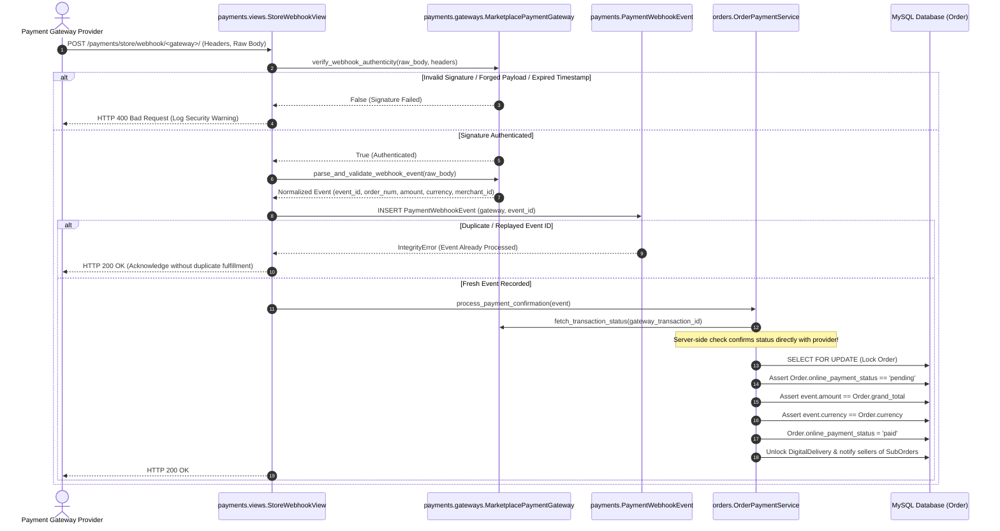
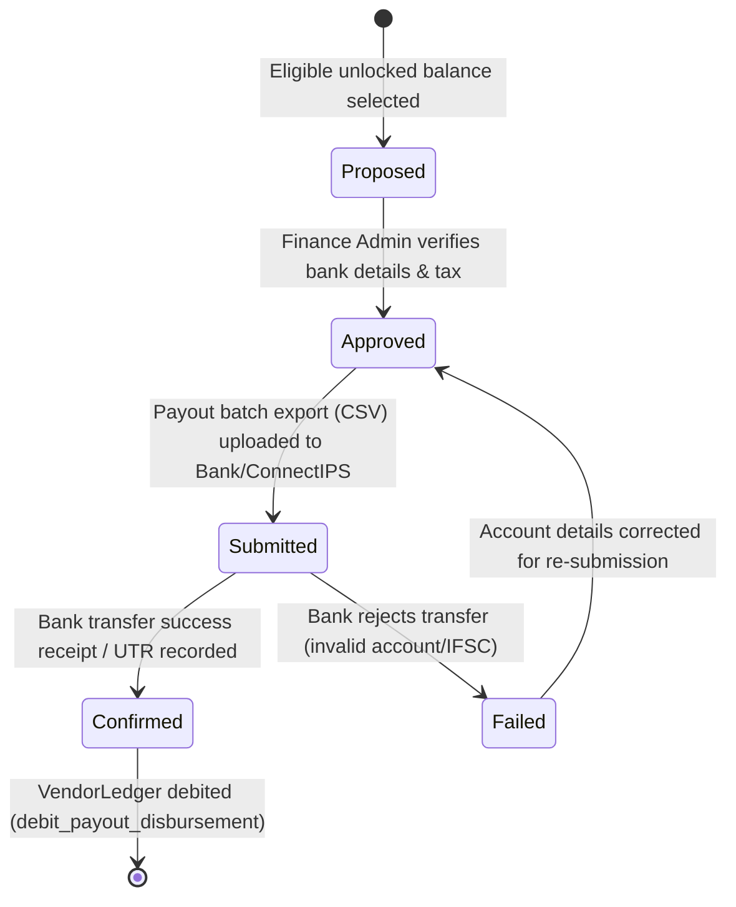

# NPTOR Store — Phased Implementation Plan & Payment Integration Strategy

**Document Version:** 2.0.0-FINAL-GATED  
**Date:** 2026-10-23  
**Status:** Implementation-Ready Planning Specification (Awaiting Gate A Sign-Off; Zero Code Executed)  
**File Location:** `docs/store/STORE_IMPLEMENTATION_PLAN.md`  
**Companion Architecture:** [`docs/store/STORE_ARCHITECTURE_DESIGN.md`](file:///D:/nptor/docs/store/STORE_ARCHITECTURE_DESIGN.md)  
**Target Codebase:** NPTOR Platform (`objective_exam`, Django 6.0, Python 3.12, MySQL/MariaDB InnoDB)

---

## Document Taxonomy & Legend
Statements throughout this design are strictly categorized:
- `[CONFIRMED REPOSITORY FINDING]`: Grounded in verified code, settings, migrations, and database schema in the current repository (`commit fd4d18d`).
- `[DESIGN SPECIFICATION]`: Formal architectural, data, or workflow design implemented to meet project requirements.
- `[PROVISIONAL DEFAULT / RECOMMENDATION]`: A sound operational default proposed by the architecture team, subject to commercial, legal, or policy ratification.
- `[UNRESOLVED DECISION]`: Explicit decision point requiring project owner approval before code execution.
- `[LEGAL / TAX NOTICE]`: Regulatory question requiring qualified local legal/tax counsel in Nepal or target jurisdictions.

---

## Table of Contents
1. [Agreed Product Scope & Market Separation Architecture](#1-agreed-product-scope--market-separation-architecture)
2. [Robust Provider-Independent Payment Security Architecture](#2-robust-provider-independent-payment-security-architecture)
3. [Immutable Double-Entry Seller Ledger & Reconciliation Architecture](#3-immutable-double-entry-seller-ledger--reconciliation-architecture)
4. [Configurable Business Policy Governance & Schema](#4-configurable-business-policy-governance--schema)
5. [Cross-Market Isolation & Educational Non-Regression Safeguards](#5-cross-market-isolation--educational-non-regression-safeguards)
6. [Phased Delivery Process & Phase-by-Phase Acceptance Gates](#6-phased-delivery-process--phase-by-phase-acceptance-gates)
   - [Phase 1: Repository Baseline, Worktree Setup & Tooling Verification](#phase-1-repository-baseline-worktree-setup--tooling-verification)
   - [Phase 2: Store Models, Migration Scaffolding & Backward-Compatibility Guards](#phase-2-store-models-migration-scaffolding--backward-compatibility-guards)
   - [Phase 3: Catalog, Taxonomy, Product Moderation & Seller Onboarding](#phase-3-catalog-taxonomy-product-moderation--seller-onboarding)
   - [Phase 4: Database-Backed Cart, Stock Reservation & Pricing Validation](#phase-4-database-backed-cart-stock-reservation--pricing-validation)
   - [Phase 5: Master Orders, Multi-Seller SubOrders, Fulfillment & COD Engine](#phase-5-master-orders-multi-seller-suborders-fulfillment--cod-engine)
   - [Phase 6: Provider-Independent Payment Pipeline & Secure Test Adapter](#phase-6-provider-independent-payment-pipeline--secure-test-adapter)
   - [Phase 7: Immutable Ledger, Refunds, Reconciliation & Seller Settlement](#phase-7-immutable-ledger-refunds-reconciliation--seller-settlement)
   - [Phase 8: Protected Digital Products & Tokenized Download Delivery](#phase-8-protected-digital-products--tokenized-download-delivery)
   - [Phase 9: Administrative Controls & Multi-Tenant Seller Workspace](#phase-9-administrative-controls--multi-tenant-seller-workspace)
   - [Phase 10: End-to-End Test Suite, Staging Verification & Release Readiness](#phase-10-end-to-end-test-suite-staging-verification--release-readiness)
7. [Five-Stage Deployment, Release & Rollback Gate Governance](#7-five-stage-deployment-release--rollback-gate-governance)
8. [Final Decision Register](#8-final-decision-register)

---

## 1. Agreed Product Scope & Market Separation Architecture

The NPTOR platform operates under a deliberate architectural bifurcation:

```
┌─────────────────────────────────────────────────────────────────────────────┐
│                          NPTOR PLATFORM SCOPE                               │
├──────────────────────────────────────┬──────────────────────────────────────┤
│      GLOBAL LEARNING PLATFORM        │        NEPAL-FIRST MARKETPLACE       │
│   (Courses, Tracks, Exams, Orgs)     │          (NPTOR Store App)           │
├──────────────────────────────────────┼──────────────────────────────────────┤
│ • Worldwide availability             │ • Physical delivery initially NEPAL  │
│ • International students & colleges  │ • Local Nepal seller onboarding      │
│ • Educational single-item checkout   │ • Cash on Delivery (COD) within Nepal│
│ • Independent pricing & currency     │ • Default Currency: NPR (Store)      │
│ • Global gateway pipeline (INR/USD)  │ • Nepal domestic gateways (eSewa/etc)│
│ • Zero physical shipping constraints │ • Digital Store products: GLOBAL*    │
└──────────────────────────────────────┴──────────────────────────────────────┘
*Subject to seller intellectual property rights and payment provider acceptance.
```

### Strategic Scope Guarantees
1. **Global Learning Platform Preserved:** NPTOR's existing organizations, institutional portals, video courses, exam tracks, practice questions, and subscriptions remain open to customers worldwide. **Under no circumstances will physical delivery constraints or Nepal-only policies be applied to educational resources, organizations, or existing checkouts.**
2. **Nepal-First Physical Marketplace:** The physical Store initially focuses on domestic retail within Nepal:
   - Platform-owned physical goods and approved third-party Nepalese sellers.
   - Domestic fulfillment and manual courier tracking (e.g. Pathao, Nepal Post, Sundar, local couriers).
   - Cash on Delivery (COD) restricted strictly to serviceable delivery addresses within Nepal.
   - Cross-border physical shipping is explicitly **out of scope** for the initial MVP.
3. **Globally Available Digital Store Goods:** Digital Store items (e-books, downloadable test bundles, revision guides, software utilities) are architected for international customer access wherever payment gateway coverage and copyright laws permit. Digital products are **never** constrained by physical geography.
4. **Currency & Payment Decoupling:** Educational checkouts and Store checkouts maintain independent currency and gateway pipelines, preventing local marketplace settings from altering international educational commerce.

---

## 2. Robust Provider-Independent Payment Security Architecture

### 2.1 Provider-Independent Abstract Boundary
`[CONFIRMED REPOSITORY FINDING]` The repository currently registers only `DummyPaymentGateway` in `payments.gateways.factory.PaymentGatewayFactory`.

The Store commerce layer establishes an abstract boundary in `payments/gateways/marketplace_base.py`. The system **does not assume every gateway uses HMAC-SHA256**:

```python
from abc import ABC, abstractmethod
from decimal import Decimal
from typing import Dict, Any

class MarketplacePaymentGateway(ABC):
    """
    Abstract provider-independent boundary for NPTOR Store commerce.
    Adapters must encapsulate provider-specific cryptographic signature 
    protocols (HMAC-SHA256, RSA public key, SHA-512, or token hashing).
    """

    @abstractmethod
    def initiate_checkout(
        self,
        *,
        order_number: str,
        amount: Decimal,
        currency: str,
        customer_email: str,
        customer_phone: str,
        success_url: str,
        cancel_url: str,
        metadata: Dict[str, Any],
    ) -> Dict[str, Any]:
        """Initiate payment session; returns redirect_url or client SDK token."""
        raise NotImplementedError

    @abstractmethod
    def verify_webhook_authenticity(
        self,
        *,
        raw_body: bytes,
        headers: Dict[str, str],
        query_params: Dict[str, str],
    ) -> bool:
        """
        Verify cryptographic authenticity using provider's documented protocol.
        Must validate timestamp freshness (replay protection) where supported.
        """
        raise NotImplementedError

    @abstractmethod
    def parse_and_validate_webhook_event(
        self,
        *,
        raw_body: bytes,
        headers: Dict[str, str],
        query_params: Dict[str, str],
    ) -> Dict[str, Any]:
        """
        Parse payload and validate: event_id, order_reference, amount, 
        currency, status, and merchant/account identifiers.
        """
        raise NotImplementedError

    @abstractmethod
    def fetch_transaction_status(self, *, gateway_transaction_id: str) -> Dict[str, Any]:
        """Server-to-server query to verify real payment status directly from provider."""
        raise NotImplementedError

    @abstractmethod
    def initiate_refund(
        self,
        *,
        gateway_transaction_id: str,
        amount: Decimal,
        reason: str,
        idempotency_key: str,
    ) -> Dict[str, Any]:
        """Execute partial or full server-to-server refund."""
        raise NotImplementedError
```

### 2.2 Payment Security, Webhook Verification & Replay Protection



### 2.3 Critical Payment Failure Mode Handling
1. **Webhook Timeout / Drop:** If a gateway webhook is dropped or delayed, the customer order remains `online_payment_status = 'pending'`. When the customer returns to the order confirmation page, the system invokes `fetch_transaction_status()` directly to synchronize the authoritative status before releasing digital downloads.
2. **Ambiguous / Pending Transactions:** If the gateway reports a transaction is "Under Review" or "Pending Bank Clearing", the order is marked `online_payment_status = 'processing'`. Stock reservations are held; fulfillment is **blocked** until a verified `paid` webhook or manual reconciliation confirms funds.
3. **Refund Failure Recovery:** If a server-to-server refund fails (e.g. gateway API timeout), `SubOrder.refund_status` remains `approved` but not `refunded`. An incident is logged to the `AdminReconciliationDesk` for manual intervention with the payment provider.
4. **Test Adapter Isolation Safeguard:**
   - `StoreDummyGatewayAdapter` is implemented strictly in `payments/gateways/store_dummy.py`.
   - Gated in code by `settings.MARKETPLACE_DUMMY_GATEWAY_ENABLED`.
   - **Production Hard-Block:** In `objective_exam/settings.py`, an explicit system check asserts:
     ```python
     if not DEBUG and os.environ.get("MARKETPLACE_DUMMY_GATEWAY_ENABLED") == "True":
         raise ImproperlyConfigured("CRITICAL: Dummy payment gateway cannot be enabled in production!")
     ```

---

## 3. Immutable Double-Entry Seller Ledger & Reconciliation Architecture

### 3.1 Double-Entry Principles & Invariants
`[DESIGN SPECIFICATION]` The seller ledger is an **immutable, double-entry financial log**. Database records reflect accounting claims and platform liability, but **never constitute proof that physical cash or bank deposits have arrived in a seller's bank account**:

$$\text{Net Seller Payable} = \sum (\text{Ledger Credits}) - \sum (\text{Ledger Debits})$$

```
┌─────────────────────────────────────────────────────────────────────────────┐
│                       DOUBLE-ENTRY TRANSACTION MATRIX                       │
├─────────────────────────────┬───────────┬───────────────────────────────────┤
│ Transaction Type            │ Debit/Cred│ Calculation / Formula             │
├─────────────────────────────┼───────────┼───────────────────────────────────┤
│ Product Merchandise Sale    │ Credit (+)│ `+ SubOrder.items_subtotal`       │
│ Platform Commission Fee     │ Debit (-) │ `- (items_subtotal * rate / 100)` │
│ Customer Shipping Collected │ Credit (+)│ `+ SubOrder.customer_shipping`    │
│ Actual Courier Freight Cost │ Debit (-) │ `- SubOrder.actual_courier_cost`  │
│ RTO Failed Delivery Freight │ Debit (-) │ `- SubOrder.actual_rto_cost`      │
│ Customer Refund Deducted    │ Debit (-) │ `- Refunded Item Amount`          │
│ Commission Reversal on Refun│ Credit (+)│ `+ Reversible Commission`         │
│ Bank Payout Disbursed       │ Debit (-) │ `- Confirmed Bank Transfer Amount`│
└─────────────────────────────┴───────────┴───────────────────────────────────┘
```

### 3.2 Five-Stage Payout Lifecycle
To prevent duplicate bank transfers or race-condition double disbursements, all vendor payouts move through five explicit states:



1. **Proposed:** Calculated by automated query: `SubOrder.seller_payable_status == 'settlement_unlocked'`.
2. **Approved:** Verified by Finance Admin against vendor KYC and tax documentation.
3. **Submitted:** Payout batch exported to bank clearing rail (NCHL / ConnectIPS).
4. **Confirmed:** Bank UTR / transaction reference number recorded; immutable ledger debit created.
5. **Failed:** Bank rejection logged; balance re-opened for correction without double-crediting.

### 3.3 Concurrency Control & Duplicate Payout Protection
- Every payout execution locks the vendor's ledger rows using `select_for_update()`.
- Each payout has an immutable, unique `payout_reference` (`PO-<VENDOR_ID>-<YYYYMMDD>-<UUID4>`).
- Database check: A `SubOrder` can be attached to **at most one** confirmed `VendorPayout`.

---

## 4. Configurable Business Policy Governance & Schema

`[PROVISIONAL DEFAULT / RECOMMENDATION]` None of the provisional commercial values are hardcoded into migrations or application constants. Every policy is dynamic, auditable, and configurable:

```
┌─────────────────────────────────────────────────────────────────────────────┐
│                       POLICY GOVERNANCE SCHEMA                              │
├─────────────────────────┬──────────────────────────┬────────────────────────┤
│ Policy Dimension        │ Storage Location         │ Technical Baseline     │
├─────────────────────────┼──────────────────────────┼────────────────────────┤
│ Settlement Holding Days │ `VendorProfile` / Global │ `7` calendar days      │
│ Platform Commission     │ `Category` / `Vendor`    │ `10.00%` provisional   │
│ COD Cart Value Ceiling  │ `StoreSetting` (DB)      │ `NPR 5,000.00`         │
│ RTO Freight Liability   │ `VendorProfile`          │ `'vendor_absorbs'`     │
│ Digital Download Limits │ `ProductDigitalAsset`    │ `5` count / `365` days │
└─────────────────────────┴──────────────────────────┴────────────────────────┘
```

### Governance & Order Snapshot Rules
1. **Order Snapshotting:** When an order is placed, active commission rates and shipping allocations are snapshotted onto `OrderItem.commission_rate_snapshot` and `SubOrder.platform_commission`. Subsequent changes to platform or vendor commission settings **never alter historical orders or active settlement holds**.
2. **Audit Logging:** Any update to a vendor's commission, settlement hold duration, or RTO liability triggers an automated row in `vendors.VendorPolicyAuditLog` capturing: `vendor_id`, `admin_user_id`, `field_name`, `old_value`, `new_value`, `reason`, and `timestamp`.

---

## 5. Cross-Market Isolation & Educational Non-Regression Safeguards

The implementation guarantees complete architectural isolation between **NPTOR Global Education** and **NPTOR Nepal Store**:

```
┌─────────────────────────────────────────────────────────────────────────────┐
│                    SEPARATED COMMERCE PIPELINE PROOF                        │
├──────────────────────────────────────┬──────────────────────────────────────┤
│ EDUCATIONAL COMMERCE PIPELINE        │ NEPAL STORE COMMERCE PIPELINE        │
├──────────────────────────────────────┼──────────────────────────────────────┤
│ Contract: `payments.PaymentOrder`    │ Contract: `orders.Order`             │
│ Target: Courses, Tracks, Plans       │ Target: Store Physical & Digital SKUs│
│ Primary Currency: `INR` (or USD)     │ Primary Currency: `NPR`              │
│ Target Gateways: Global Gateways     │ Target Gateways: Nepal Gateways      │
│ (Razorpay, Stripe, PayPal)           │ (Khalti, eSewa, ConnectIPS)          │
│ Delivery Constraints: None (Global)  │ Delivery Constraints: Nepal (Physical│
│ Fulfill: `PaymentFulfillmentService` │ Fulfill: `StoreFulfillmentService`   │
└──────────────────────────────────────┴──────────────────────────────────────┘
```

---

## 6. Phased Delivery Process & Phase-by-Phase Acceptance Gates

### Phase 1: Repository Baseline, Worktree Setup & Tooling Verification
- **Scope & Expected Deliverables:**
  - Create dedicated isolated development branch: `feature/store-commerce-foundation`.
  - Validate Python 3.12, Django 6.0, MySQL InnoDB environment.
  - Run and verify 100% pass rate on existing educational test suite (`payments`, `subscriptions`, `courses`, `quiz`, `accounts`).
  - Establish `docs/store/` tracking standards in Git.
- **Dependencies & Prerequisites:** Current repository at commit `fd4d18d`.
- **Required Tests:** Existing educational test suite execution.
- **Acceptance Criteria & Evidence:**
  - `python manage.py check` returns 0 errors.
  - Baseline educational tests pass with documented terminal output.
- **Rollback Approach:** Discard branch; working tree returns to `fd4d18d`.
- **Gate Condition:** Gate A approved by project owner.

---

### Phase 2: Store Models, Migration Scaffolding & Backward-Compatibility Guards
- **Scope & Expected Deliverables:**
  - Create four Django apps: `store`, `cart`, `orders`, `vendors`.
  - Implement domain models, check constraints, indexes, and initial migrations.
  - Mount new apps in `objective_exam/settings.py`.
- **Dependencies & Prerequisites:** Phase 1 complete.
- **Required Tests:**
  - Model creation tests for all new models.
  - Non-regression test proving `payments.PaymentOrder` is unmodified.
- **Acceptance Criteria & Evidence:**
  - `python manage.py makemigrations --check` shows no unapplied changes.
  - `python manage.py check` passes with 0 issues.
- **Rollback Approach:** Delete new app directories and unmount from settings.

---

### Phase 3: Catalog, Taxonomy, Product Moderation & Seller Onboarding
- **Scope & Expected Deliverables:**
  - Storefront catalog views (category tree, filters, search, PDP).
  - Seller onboarding views (business registration, PAN/VAT input, bank details).
  - Product submission workflow for sellers and administrative moderation queue.
- **Dependencies & Prerequisites:** Phase 2 complete.
- **Required Tests:**
  - `test_store_catalog_filters`: Active approved products display; draft/rejected products hidden.
  - `test_product_moderation_state_machine`: Transitions from `draft` to `approved`.
  - `test_seller_product_isolation`: Seller A cannot edit Seller B's products.
- **Acceptance Criteria & Evidence:**
  - Public catalog loads with HTTP 200 using Bulma responsive layout.
  - Moderation queue successfully approves and rejects submissions.
- **Rollback Approach:** Remove store views and templates; models remain dormant.

---

### Phase 4: Database-Backed Cart, Stock Reservation & Pricing Validation
- **Scope & Expected Deliverables:**
  - Persistent database `Cart` and `CartItem` supporting session keys and authenticated users.
  - `StockReservation` service using deadlock-free `select_for_update()` ordered by `variant_id`.
  - Scheduled reservation cleanup task (`python manage.py release_expired_reservations`).
  - Price change validation at checkout submission.
- **Dependencies & Prerequisites:** Phase 3 complete.
- **Required Tests:**
  - `test_stock_reservation_concurrency`: 10 simultaneous threads compete for 1 stock item; exactly 1 succeeds.
  - `test_expired_reservation_cleanup`: Expired reservation restored cleanly.
  - `test_price_change_blocks_checkout`: Changed price triggers warning and aborts checkout.
- **Acceptance Criteria & Evidence:**
  - Zero negative inventory or deadlock occurrences under simulated concurrency.
- **Rollback Approach:** Disable cart views and URLs.

---

### Phase 5: Master Orders, Multi-Seller SubOrders, Fulfillment & COD Engine
- **Scope & Expected Deliverables:**
  - Immutable `ShippingAddress` with Nepal district/province fields.
  - Master `Order` partitioning into vendor-specific `SubOrder` records.
  - Nepal Geographic Gate (blocks non-Nepal physical checkout).
  - Mixed Cart Rule (disables COD if digital items present).
  - COD Eligibility Validator (seller enabled, product enabled, value <= NPR 5,000).
  - Manual courier tracking interface for sellers (carrier name and tracking number).
- **Dependencies & Prerequisites:** Phase 4 complete.
- **Required Tests:**
  - `test_order_splitting_multi_vendor`: Cart with 3 vendors creates 1 Order and 3 SubOrders.
  - `test_nepal_physical_delivery_gate`: Physical checkout with non-Nepal address raises ValidationError.
  - `test_mixed_cart_disables_cod`: Mixed cart disallows COD payment method.
  - `test_delivery_scan_does_not_mark_paid`: SubOrder `delivered` leaves COD `pending_delivery`.
- **Acceptance Criteria & Evidence:**
  - Cart splits cleanly into distinct suborders with matching subtotals.
- **Rollback Approach:** Disable checkout view routing.

---

### Phase 6: Provider-Independent Payment Pipeline & Secure Test Adapter
- **Scope & Expected Deliverables:**
  - Abstract `MarketplacePaymentGateway` boundary in `payments/gateways/marketplace_base.py`.
  - `StoreDummyGatewayAdapter` in `payments/gateways/store_dummy.py`.
  - Production guard in `settings.py` preventing dummy gateway activation in production.
  - Store payment service with webhook signature verification and transaction status verification.
  - Independent webhook endpoint: `/payments/store/webhook/<gateway>/`.
- **Dependencies & Prerequisites:** Phase 5 complete.
- **Required Tests:**
  - `test_webhook_signature_verification`: Forged signature returns HTTP 400.
  - `test_webhook_idempotency`: Duplicate webhook delivery does not double-fulfill.
  - `test_store_payment_pipeline_cannot_affect_educational_checkout`: Verifies educational checkout using `PaymentOrder` (INR) is completely isolated and unaffected.
- **Acceptance Criteria & Evidence:**
  - Automated test adapter processes checkout and webhook cleanly.
  - Educational checkout tests pass with 0 regressions.
- **Rollback Approach:** Remove store payment webhook URLs and service files.

---

### Phase 7: Immutable Ledger, Refunds, Reconciliation & Seller Settlement
- **Scope & Expected Deliverables:**
  - Double-entry `VendorLedger` service for sales, commissions, courier costs, and refunds.
  - Admin COD Remittance Reconciliation tool: Confirms courier bank deposits.
  - Configurable RTO liability engine (`vendor_absorbs` default).
  - Payout batch generator: Five-stage payout lifecycle (`proposed` -> `confirmed`).
- **Dependencies & Prerequisites:** Phase 6 complete.
- **Required Tests:**
  - `test_ledger_invariants`: Credits minus debits equals payable balance.
  - `test_cod_remittance_unlocks_settlement_hold`: Deposit remittance initiates 7-day hold.
  - `test_payout_idempotency_prevents_double_disbursement`: Payout retry cannot double-debit.
- **Acceptance Criteria & Evidence:**
  - Zero financial discrepancies in ledger reconciliation tests.
- **Rollback Approach:** Disable payout and reconciliation views.

---

### Phase 8: Protected Digital Products & Tokenized Download Delivery
- **Scope & Expected Deliverables:**
  - Protected storage directory outside web root (`/home3/nptorcom/protected_storage/`).
  - Digital delivery token generator (SHA-256 tokens).
  - Streaming view (`orders.views.DigitalDownloadView`): Validates user, token, counter, and expiry before streaming chunked binary.
- **Dependencies & Prerequisites:** Phase 7 complete.
- **Required Tests:**
  - `test_digital_download_owner_success`: Authorized user downloads file.
  - `test_digital_download_unauthorized_forbidden`: Cross-user download blocked.
  - `test_digital_download_limit_exhausted`: Exceeded limit returns HTTP 410 Gone.
  - `test_direct_media_url_blocked`: Direct URL access returns HTTP 404.
- **Acceptance Criteria & Evidence:**
  - Downloads stream securely without revealing physical file paths.
- **Rollback Approach:** Disable digital download view.

---

### Phase 9: Administrative Controls & Multi-Tenant Seller Workspace
- **Scope & Expected Deliverables:**
  - Seller Workspace (`/vendors/dashboard/`): Scoped to `request.user.vendor_profile` (products, suborders, ledger).
  - Admin Store Desk (`/dashboard/admin/store/`): Moderation, COD remittance, payout batches.
  - Reuses Bulma 0.9.4 layout (`templates/layouts/admin/base_admin.html`).
- **Dependencies & Prerequisites:** Phase 8 complete.
- **Required Tests:**
  - `test_seller_workspace_queryset_isolation`: Seller A receives HTTP 404 attempting to access Seller B's suborders or ledger.
  - `test_customer_pii_minimization`: Seller context excludes customer billing details and emails.
- **Acceptance Criteria & Evidence:**
  - Zero cross-tenant data leakage under automated tests.
- **Rollback Approach:** Unmount workspace routes.

---

### Phase 10: End-to-End Test Suite, Staging Verification & Release Readiness
- **Scope & Expected Deliverables:**
  - Full automated regression test suite covering all apps (> 100 tests).
  - Cross-market integration tests proving global education remains 100% operational.
  - Staging deployment runbook and execution on `/home3/nptorcom/repositories/nptor_staging/project`.
  - Complete release readiness documentation.
- **Dependencies & Prerequisites:** Phases 1–9 complete.
- **Required Tests:**
  - Complete suite run: `python manage.py test`.
- **Acceptance Criteria & Evidence:**
  - 100% tests pass on local and staging environments.
  - Staging smoke tests confirm storefront, cart, checkout, and admin dashboard function cleanly.
- **Rollback Approach:** Reset staging repository to pre-release commit.

---

## 7. Five-Stage Deployment, Release & Rollback Gate Governance

To ensure zero unapproved changes touch production:

```
┌─────────────────────────────────────────────────────────────────────────────┐
│                       EXPLICIT GOVERNANCE GATES                             │
├─────────┬──────────────────────┬────────────────────────────────────────────┤
│ Gate A  │ Plan Approval        │ Owner formally approves implementation plan│
│ Gate B  │ Development          │ AGY builds phases on local branch + tests  │
│ Gate C  │ Staging Deployment   │ Explicit authorization to deploy to staging│
│ Gate D  │ Live Payment Active  │ Live gateway selected, verified & approved │
│ Gate E  │ Production Release   │ Pre-migration backup gates & prod deploy   │
└─────────┴──────────────────────┴────────────────────────────────────────────┘
```

> [!IMPORTANT]
> **Strict Governance Rule:** Plan approval (Gate A) permits **only local branch development and automated testing**. It does **NOT** grant authorization to merge into `main`, deploy to staging, deploy to production, enable live payments, or alter production database records.

---

## 8. Final Decision Register

```
┌─────────────────────────────────────────────────────────────────────────────┐
│                            FINAL DECISION REGISTER                          │
├─────────────────────────────────────────────────────────────────────────────┤
│ Category A: Confirmed Scope & Architectural Baselines                       │
│ Category B: Proposed Technical Defaults                                     │
│ Category C: Commercial & Legal Decisions Requiring Explicit Owner Sign-Off   │
│ Category D: Technical Questions Resolved from Repository Evidence           │
└─────────────────────────────────────────────────────────────────────────────┘
```

### Category A: Confirmed Scope & Architectural Baselines
1. **Scope:** Global educational platform preserved; Nepal-first physical Store; worldwide digital Store products where permitted.
2. **Architecture:** Native Django modular monolith (`store`, `cart`, `orders`, `vendors`) in `D:\nptor`.
3. **Pipeline Decoupling:** Educational `PaymentOrder` (INR) and Store `Order` (NPR) remain completely independent.
4. **Fulfillment & COD Gating:** Delivery scan != proof of payment. COD orders become paid only upon reconciled bank deposit remittance. COD disabled for digital items.
5. **Internal Settlement Hold:** 7-day post-delivery hold is an internal contractual accounting hold, not a regulated financial escrow service.
6. **Cancellation & Returns:** Feasibility-based cancellation prior to manifest; door refusal for in-transit items; formal inspection/return workflow post-delivery.

### Category B: Proposed Technical Defaults
1. **Internal Settlement Hold Duration:** 7 calendar days after confirmed delivery before seller funds unlock for payout.
2. **Stock Reservation TTL:** 15-minute expiration timer on checkout stock holds.
3. **Digital Download Limits:** 5 downloads per purchase with a 365-day validity window.
4. **COD Cart Value Ceiling:** Maximum NPR 5,000 per COD order to mitigate uncollected freight exposure.
5. **RTO Freight Liability Default:** `vendor_absorbs` (seller is debited for courier forward and return freight on customer-refused deliveries).
6. **Platform Commission Baseline:** Provisional 10% platform fee on merchandise subtotal.

### Category C: Commercial & Legal Decisions Requiring Explicit Owner Sign-Off
1. **Confirmation of Provisional Defaults:**
   - Confirm whether the 7-day settlement hold, 10% provisional commission baseline, and NPR 5,000 COD limit are approved as operating policies.
   - Confirm whether `vendor_absorbs` is approved as the policy for customer-refused COD courier freight.
2. **Nepalese Gateway Provider Selection:**
   - *Candidates:* Khalti, eSewa, Fonepay, or ConnectIPS.
   - *Decision:* Select the domestic gateway partner to implement after Phase 6. Gateway selection is deferred until merchant terms, automated refund APIs, and fee structures are verified.
3. **Dual Gateway Approach:**
   - Confirm operating dual payment gateways: international gateway (e.g. Stripe/Razorpay) for global educational purchases, and domestic gateway (Khalti/eSewa) for Nepal Store purchases.
4. **Nepalese Tax & Statutory Legal Advice:**
   - Obtain qualified Nepalese legal/tax advice regarding TDS deduction rates on seller payouts and marketplace operator registration requirements under Nepal's E-Commerce Act.

### Category D: Technical Questions Resolved from Repository Evidence
1. *Can educational courses and Nepal store items share currency?* **No.** Existing educational plans use `INR` (or USD), while the Nepal Store uses `NPR`. The models and pipelines must remain distinct.
2. *Can carts be stored in cache?* **No.** Production uses `LocMemCache` (per-process). Carts must be stored in MySQL.
3. *Can Celery be used for background jobs?* **No.** No task broker is configured in settings. Jobs must run in-request or via cron management commands.
4. *Can `payments.PaymentOrder` be repurposed?* **No.** Its `clean()` method and foreign keys strictly enforce single educational resources. A dedicated `orders.Order` model is required.
5. *Can digital files be stored in `/media/`?* **No.** Public media storage is not access-gated. A dedicated `/home3/nptorcom/protected_storage/` root is required.

---
*End of Refined Implementation Plan Specification. Ready for Gate A Review & Authorization.*
